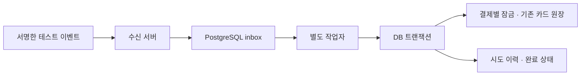

# 카드 이벤트 수신과 재처리

`005_card_event_inbox.sql`은 카드 이벤트 접수와 장부 반영을 분리한다. 수신 응답을 보낸 뒤 프로세스가 중단되거나 같은 요청을 다시 받아도 처리할 내용은 PostgreSQL에 남는다. 현재 입력은 **Aqua 자체 sandbox 형식**이며 Reap 또는 다른 발급사의 웹훅 규격을 구현한 것이 아니다.

**HTTP 202는 이벤트를 저장했다는 뜻이다. 카드 승인 결과가 아니다.** 실제 발급사의 실시간 승인 응답·타임아웃·한도 결정 경로는 별도로 연결해야 한다. 현재 정규화 이벤트의 `authorize`는 테스트 원장 상태를 재현하기 위한 명령이다.

## 처리 구조



수신 서버는 원문 바이트의 서명을 검증한 뒤 엄격한 이벤트 형식만 저장한다. 같은 이벤트 ID·같은 내용은 기존 접수 번호와 최초 수신 시각을 반환한다. 같은 ID의 내용을 바꾸면 409다. DB 커밋을 확인하기 전에 202를 보내지 않는다. 응답이 끊겼으면 같은 이벤트 ID·내용에 새 전송 시각과 서명을 붙여 재전송한다.

작업자는 먼저 결제별 처리 잠금을 잡고, 처리 가능한 이벤트 한 건을 선택한다. 잠긴 다른 결제는 `SKIP LOCKED`로 건너뛰므로 여러 작업자가 서로 다른 결제를 처리할 수 있다. 접수 순서는 DB 순번으로 보존하며 같은 밀리초의 UUID 정렬에 의존하지 않는다.

같은 결제의 마지막 매입이나 승인 해제가 먼저 접수한 미처리 매입을 추월하지 못한다. 앞선 매입이 재시도 대기·검토 상태인 경우에도 기다린다. 반면 승인 전에 들어온 매입·환불이 후속 승인 처리를 막지는 않는다. **아직 받지 못한 앞선 이벤트의 존재는 추론하지 않는다.** 실제 발급사가 마지막 매입을 먼저 보내는 경우에는 공급업체의 순번·누적 매입액·조회 규칙을 확인해 어댑터에서 조정해야 한다.

한 트랜잭션에서 기존 카드 원장 함수를 호출하고 처리 결과와 완료 상태를 함께 기록한다. 외부 네트워크 호출은 없다. 별도 작업 임대나 완료 확인 요청 없이, 프로세스 종료 시 원장과 inbox 상태가 함께 롤백되고 잠금이 풀린다. 원장의 지연 제약도 실패 처리용 하위 트랜잭션 안에서 검사한다. 실패한 장부 변경은 되돌리고 안전한 오류 코드와 시도 이력만 커밋한다.

최초 수신 시각을 매 재시도에 같은 값으로 전달하므로 한국 시간 자정·월말 이후 처리해도 페이백 귀속월이 이동하지 않는다. 프로그램 활성 여부와 리워드 사용 설정·재원 구성은 실제 원장 승인 처리 시점에 확정된다. 수신 시점에 결제액을 확보한 것으로 표시하지 않는다.

007 이후 카드 연결·잠금 상태도 실제 처리 시점에 검사한다. 카드 없음·잠금·상태 미확정의 정책 거절은 변경 불가 결정 이력과 `dead_letter`를 함께 커밋한다. 잠금 해제 후에도 같은 이벤트를 승인으로 바꾸거나 운영자 명령으로 재처리할 수 없다. [카드 승인 정책](card-authorization-policy.md)을 참고한다. 이 규칙은 sandbox 승인 명령용이며 실제 발급사의 승인 완료 통보에 현재 잠금 상태를 적용해 정산을 거부하는 규칙이 아니다.

## 실패와 운영자 조치

| 상태 | 의미 |
| --- | --- |
| `pending` | 저장됐고 처리를 기다림 |
| `retry` | 선행 상태나 일시적 장애를 기다림 |
| `applied` | 원장과 완료 기록이 함께 커밋됨 |
| `dead_letter` | 자동 처리를 멈추고 원본·실패 이력을 보존함 |

한 처리 주기는 최대 8번 시도한다. 재시도 간격은 1초, 5초, 15초, 1분, 5분, 15분, 1시간이다. 승인 누락, 상태 충돌, 회사 리워드 재원 부족, 장부 대응 재원 불일치, 잠금 경합과 내부 처리 오류만 제한적으로 재시도한다. 잔액 부족·소유자 불일치·이벤트 ID 충돌 같은 확정 거절은 자동 또는 수동 재처리로 승인하지 않는다. 이미 거절한 승인을 나중의 입금 때문에 되살리지 않는다.

운영자 재처리는 재시도 가능한 원인으로 중단된 건에만 허용한다. 현재 버전, 작업 요청 키와 10~500자의 사유가 필요하며 DB 로그인 역할·이전/다음 버전을 변경 불가 이력에 남긴다. 같은 작업 키 재실행은 최초 응답을 반환한다. 총 시도 횟수는 유지하고 새 주기의 횟수만 0으로 돌린다. 원본 이벤트는 수정하지 않는다. 실제 운영 재처리 승인 절차와 발급사별 조정 절차는 별도 운영 시스템에서 정해야 한다.

연결 종료·트랜잭션 취소로 전부 롤백된 시도는 기록되지 않는다. 8회는 **커밋된 실패 시도** 기준이다. 작업자는 DB 접속 오류를 최대 30초 간격으로 재시도하고, 분당 상태 집계와 처리 결과를 구조화 로그로 남긴다. 검토 건수·오래된 대기 건·작업자 오류에 대한 알림 채널은 아직 배포하지 않았다. 앞선 매입 때문에 처리할 수 없는 후속 이벤트는 대기 상태를 유지한다.

## 실행과 권한

웹 API는 `DATABASE_URL`, 수신은 `INGRESS_DATABASE_URL`, 작업자는 `WORKER_DATABASE_URL`의 **서로 다른 DB 역할**을 사용한다. 수신은 접수 함수 실행과 마이그레이션 이력 조회만 허용한다. 작업자는 처리·집계 함수 실행과 마이그레이션 이력 조회만 허용한다. 두 역할 모두 회원 정보 조회·직접 원장 수정·inbox 직접 변경·운영자 재처리를 할 수 없다. 웹 API 역할도 inbox 접수·처리·재처리 함수를 실행할 수 없다. 역할이 겹치면 마이그레이션 설정 검사가 거절하고, 불필요한 조회·쓰기·함수 실행 권한이 추가되면 수신 서버·작업자 시작 시 거절한다.

기존 개발 볼륨에는 새 로컬 역할을 한 번 추가한다. 기존 역할의 자격 증명이나 데이터를 덮어쓰지 않는다.

```bash
docker compose exec -T postgres psql -U aqua -d aqua -v ON_ERROR_STOP=1 < docker/postgres-init.sql
DATABASE_INGRESS_ROLE=aqua_ingress DATABASE_WORKER_ROLE=aqua_worker npm run db:migrate
```

`.env.example`의 `INGRESS_DATABASE_URL`, `DATABASE_INGRESS_ROLE`, `WORKER_DATABASE_URL`, `DATABASE_WORKER_ROLE`을 개인 `.env`에도 반영한다. 수신·작업자는 웹 API 연결을 대신 사용하지 않는다. 이후 아래 순서로 기존 [카드 JSON 예시](card-payment-server.md)를 접수하고 처리할 수 있다. 직접 실행하는 기존 `server:card`와 달리 `server:inbox enqueue`는 잔액을 바꾸지 않는다.

```bash
npm run server:inbox -- enqueue data/card-events/authorize.json
npm run server:card:worker -- --once
npm run server:inbox -- status
npm run server:inbox -- status INBOX_UUID
npm run server:inbox -- retry INBOX_UUID CURRENT_VERSION RETRY_KEY '선행 승인 기록 확인 후 다시 처리'
```

조회·재처리에는 `MIGRATION_DATABASE_URL`이 명시돼 있어야 한다. 조회는 원문과 금융 응답을 출력하지 않고 집계 또는 지정 기록의 메타데이터와 최근 시도·재처리 이력을 최대 100개씩 반환한다. 금액·시각의 DB 정수는 문자열로 보존한다. `due`는 예정 시간이 지난 건수이며, 앞선 매입 때문에 막힌 후속 이벤트도 포함한다. 테스트 접수·수동 재처리 CLI는 `NODE_ENV=production`에서 거절한다.

`server:card:worker`를 인자 없이 실행하면 계속 처리한다. SIGTERM·SIGINT에는 새 처리를 멈추고 현재 트랜잭션을 마친 뒤 종료한다. `--once`는 한 건 또는 유휴 결과를 출력한다. 종료 코드는 0이 정상 처리·예약·유휴, 2가 검토 전환, 1이 실행 실패다. 운영 이미지에서는 `node dist-server/card-worker.js`를 별도 프로세스로 실행하며 검증된 DB TLS와 제한된 작업자 역할이 필요하다.

공통 Docker 이미지의 기본 `HEALTHCHECK`는 API의 `/api/live`를 호출한다. 작업자는 HTTP 서버를 열지 않으므로 전용 컨테이너에서는 `docker run --no-healthcheck` 또는 Compose의 `healthcheck: { disable: true }`를 설정한다. 작업자의 프로세스 종료·생존 신호와 카드 수신 큐의 처리 지연·검토 대상을 감시한다. [운영 지표와 알림](operations-monitoring.md)

## 서명한 HTTP 테스트

`server:card:ingress`는 기본 `127.0.0.1:3004`에서 수신한다. 명시적인 `AQUA_CARD_WEBHOOK_KEYS`가 없으면 시작하지 않으며 운영 환경에서는 실행을 거절한다. 설정은 `{"local":"BASE64URL_SECRET"}` 형태의 JSON이다. 비밀값은 난수 32바이트를 패딩 없는 base64url로 인코딩한다. 기본 키는 없으며 Git·로그에 넣지 않는다. 최대 두 키를 함께 설정해 발신자를 새 키로 전환한 후 이전 키를 제거할 수 있다.

`POST /webhooks/sandbox/cards`는 UTF-8 `application/json` 원문 최대 16 KiB만 받는다. 압축·인코딩 본문, 추가 필드와 카드 번호·보안 코드 필드는 거절한다. 원문을 디코딩하거나 정규화하기 전에 서명을 확인한다.

| 헤더 | 값 |
| --- | --- |
| `x-aqua-key-id` | 설정한 키 이름, 영문·숫자·`_`·`-` 1~32자 |
| `x-aqua-timestamp` | 전송 당시 Unix 초, 서버 시각과 최대 300초 차이 |
| `x-aqua-signature` | `v1=` 뒤 HMAC-SHA256 소문자 16진수 64자 |

서명 대상은 UTF-8 문자열 `sandbox.cards.v1.KEY_ID.TIMESTAMP.`와 **전송할 JSON 원문 바이트**를 이어 붙인 값이다. 공백이 바뀌어도 서명을 다시 계산해야 한다. 헤더 중복, 알 수 없는 키, 서명 변조, 허용 시간을 벗어난 요청은 401로 거절한다. 성공 202, 내용 충돌 409, 저장 결과 불확실 503을 반환한다. 503은 같은 이벤트로 재전송한다. 수신기의 `GET /live`는 프로세스 응답을 확인한다. `GET /health`는 해당 배포의 마이그레이션 이력, 쓰기 가능한 기본 DB, 접수 함수 실행 권한을 확인한다. 준비가 되면 200, 준비가 되지 않았거나 2초 안에 확인할 수 없으면 503이다.

## 검증 범위

2026-11-19 기준 이번 변경의 검사 30개를 포함해 서버 테스트 139개와 제품·클라이언트 로직 127개가 통과했다. 추가된 검사는 inbox 16개, 서명 수신 10개, 작업자·역할 분리 4개다. 컴파일한 작업자의 실행과 개발 DB 내부 장부 대사도 확인했다.

실제 PostgreSQL 통합 테스트는 동시 접수·다중 작업자, 부분/최종 매입 순서, 선행 승인 누락, 실패 격리·연결 종료 롤백, 월말 재처리, 재시도 소진과 감사 이력, 제한된 역할을 검사한다. 실제 HTTP 요청에서 접수 후 잔액이 그대로이고 별도 작업자 프로세스가 실행된 후에만 원장이 바뀌는 것도 확인한다. 서명 테스트와 작업자 종료·재시작 검사가 서버 CI에 포함된다. 기존 브라우저 검사와 장부 대사도 유지한다.

이는 실제 발급사 이벤트의 수신 성공이나 운영 배포를 뜻하지 않는다. 공급업체별 서명·카드/회원 매핑·순번, 실시간 승인, 승인 만료·늦은 매입·분쟁, 외부 정산 대사와 운영 부하·복구 검증은 남아 있다. 별도 `006`에서 구현한 [발급사 요청 outbox](issuer-command-outbox.md)는 테스트 카드 잠금·해제의 발신과 조회 복구를 다룬다.
