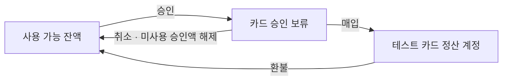

# 카드 결제 서버 처리

카드 승인은 금액을 확보하고, 매입은 확보한 금액을 실제로 차감한다. 승인 취소와 미사용 승인액 해제는 사용 가능 잔액을 복구한다. 매입 후 환불은 원래 매입액 안에서 별도 거래로 기록한다.

현재 구현은 PostgreSQL의 **TEST_KRW 테스트 원장**이다. 내부 운영자 CLI가 정규화한 이벤트를 넣고 연결 웹 화면에서 본인 결제 내역을 확인한다. 카드 발급사나 가맹점으로 요청을 보내거나 실제 자금을 정산하지 않는다. Reap 등 특정 업체의 웹훅 형식을 확정한 문서가 아니다.

## 잔액과 원장

| 계정 | 역할 |
| --- | --- |
| 사용 가능 잔액 | `user:<userId>`. 송금과 새 카드 승인에 사용할 수 있는 테스트 금액. |
| 카드 승인 보류 | `hold:<userId>`. 승인됐지만 아직 매입하거나 해제하지 않은 금액. 다른 송금·승인에 다시 사용할 수 없다. |
| 카드 정산 계정 | `system:card_settlement`. 테스트 매입과 환불의 상대 계정. 실제 카드사 정산 계좌를 의미하지 않는다. |



각 이동은 같은 금액의 양쪽 계정 기록을 가진다. 기존 거래를 수정해 취소하지 않고 반대 방향의 새 거래를 남긴다. 승인·매입·환불 이벤트, 결제 상태와 원장 반영은 하나의 DB 트랜잭션으로 처리한다.

송금과 카드 승인은 같은 사용 가능 계정의 잠금을 사용한다. 동시에 들어와도 먼저 사용한 금액을 다시 쓸 수 없다. 카드 보류액도 회원별 계정과 결제별 금액으로 함께 추적한다.

현재 카드 명령은 공통 테스트 정산 계정도 잠그므로 서로 다른 회원의 카드 명령이 직렬로 처리된다. 상태와 원장 일관성을 확인하는 현재 범위의 선택이며, 운영 처리량을 검증했다는 의미가 아니다. 실제 파트너 연결 전에는 정산 계정 구분과 잠금 범위, 처리량을 함께 검토한다.

## 이벤트와 처리 범위

공통 필드는 `eventId`, `paymentId`, `userId`, `kind`다. `eventId`는 개별 처리 요청, `paymentId`는 승인부터 환불까지 이어지는 결제, `userId`는 해당 테스트 회원을 식별한다.

007 이후 새 승인은 회원에게 연결된 sandbox 카드가 필요하다. 잠금 요청 접수부터 승인을 중단하고, 해제 성공을 확인한 뒤 새 승인을 허용한다. 정책 거절은 기록으로 남아 재전송해도 뒤늦게 승인되지 않는다. 기존 승인 건의 매입·취소·환불은 카드 잠금에 영향을 받지 않는다. [카드 승인 정책](card-authorization-policy.md)에 검사·경합·구버전 처리 범위를 정리했다.

| `kind` | 추가 필드 | 처리 |
| --- | --- | --- |
| `authorize` | `amountWon`, `merchantName` | 사용 가능 잔액에서 승인액을 확보하고 결제를 만든다. |
| `capture` | `amountWon`, `finalCapture` | 남은 승인액 안에서 매입한다. 여러 번 나누어 매입할 수 있다. |
| `reverse` | 없음 | 아직 매입하지 않은 승인액을 전부 해제한다. 이미 매입한 금액은 유지한다. |
| `refund` | `amountWon` | 아직 환불하지 않은 매입액 안에서 사용 가능 잔액으로 반환한다. 부분 환불을 반복할 수 있다. |

`finalCapture: false`는 이번 매입 후에도 남은 승인액을 확보해 둔다. `true`는 이번 매입으로 승인을 마감하고 남은 금액을 함께 해제한다. 예를 들어 60,000원 승인 후 40,000원을 마지막 매입으로 처리하면 20,000원은 즉시 사용 가능 잔액으로 돌아온다.

금액은 1원 이상의 안전한 정수만 받는다. 식별자는 영문·숫자로 시작하는 128자 이내의 값이며 영문·숫자·`.`·`_`·`:`·`-`를 허용한다. 가맹점 이름은 100자 이내이고 제어 문자를 넣을 수 없다. 이벤트에 정의되지 않은 필드는 거절한다. 카드 번호, 보안 코드, 임의의 메타데이터나 공급업체 원문을 이 명령에 넣지 않는다.

같은 이벤트 ID와 같은 내용으로 재시도하면 최초 처리 결과를 반환한다. 이후 다른 매입이나 환불이 있었더라도 재시도의 반환값은 최초 결과다. 최신 잔액은 `GET /api/account`에서 다시 조회한다. 같은 이벤트 ID의 내용을 바꾸면 충돌로 거절하며, 승인·매입·환불마다 서로 다른 이벤트 ID를 사용한다.

승인보다 먼저 도착한 매입처럼 선행 상태가 없는 요청이나 금액을 초과한 요청은 원장에 반영하지 않는다. 선행 상태를 확인한 뒤 같은 이벤트 ID와 내용으로 다시 시도할 수 있다. 현재 CLI는 이벤트 전달 큐나 자동 재처리를 제공하지 않는다.

## 화면과 조회 계약

인증된 `GET /api/account` 응답 한 번에 다음 값이 포함된다. 요청의 회원은 서버 세션으로 결정한다.

| 필드 | 의미 |
| --- | --- |
| `balanceWon` | 사용 가능한 잔액. 기존 송금 API와 같은 의미를 유지한다. |
| `heldBalanceWon` | 아직 매입·해제하지 않은 카드 승인액 합계. |
| `totalBalanceWon` | 사용 가능 잔액과 승인 보류액의 합계. 이미 매입한 금액은 포함하지 않는다. |
| `cardPayments` | 로그인한 회원의 카드 결제 내역. |
| `transactions` | 기존 테스트 적립·회원 송금 내역. 카드 결제는 별도 목록에서 보여 준다. |
| `rewards` | 카드 전용 리워드의 사용 가능·보류·조정 대기와 월 페이백. 원금 잔액에 합산하지 않는다. |

결제별 내역은 가맹점, 상태, 최초 승인액(`authorizedWon`), 남은 보류액(`heldWon`), 누적 매입액(`capturedWon`), 누적 해제액(`releasedWon`), 누적 환불액(`refundedWon`), 생성·갱신 시각을 제공한다. 환불액은 매입액에서 지우지 않고 별도로 표시한다.

004 이후의 리워드 적용 결제는 `funding.principal`, `funding.rewards`에 재원별 구성을, `cashback`에 승인 시 정책과 대기·지급·회수·상계를 제공한다. 결제별 총 보류액에는 리워드도 포함되지만 계정의 `heldBalanceWon`은 원금만 포함한다. 구버전 이벤트의 최초 응답 JSON은 다시 계산하지 않으므로 추가 필드가 없을 수 있다.

| 상태 | 의미 |
| --- | --- |
| `authorized` | 승인액을 확보했고 아직 매입하지 않았다. |
| `partially_captured` | 일부 매입했고 승인 보류액이 남아 있다. |
| `captured` | 매입한 금액이 있고 승인 보류액은 모두 매입·해제했다. |
| `cancelled` | 매입 없이 승인액을 전부 해제했다. |
| `partially_refunded` | 환불이 발생했고 미환불 매입액 또는 승인 보류액이 남아 있다. |
| `refunded` | 승인 보류액이 없고 매입액을 전부 환불했다. |

환불과 미매입 승인액이 함께 남아 있으면 `partially_refunded`로 표시한다. 상태 하나로 금액 구성을 추정하지 않고 보류·매입·환불액을 함께 확인한다.

웹 화면은 이 응답을 갱신해 잔액과 카드 내역을 함께 보여 준다. 일반 회원용 승인·매입·취소·환불 쓰기 API나 실행 버튼은 제공하지 않는다.

## 로컬에서 확인

[서버 개발 안내](server-development.md)에 따라 PostgreSQL과 API·연결 웹 화면을 실행하고 `npm run db:migrate`를 적용한다. API와 CLI는 같은 `DATABASE_URL`·`DATABASE_SCHEMA`를 사용해야 한다. 아래 예시는 새 테스트 계정 하나로 시작한다.

1. 연결 화면에서 `alice@example.test` 계정을 만든다. 로그인 후 브라우저 개발자 도구의 Network에서 `GET /api/account` 응답의 `user.id`를 확인한다. 아래 JSON의 `USER_ID`를 이 값으로 바꾼다.
2. 해당 계정에 100,000원의 테스트 금액을 한 번 적립한다.

```bash
npm run server:credit -- alice@example.test 100000 card-guide-credit-001
npm run server:issuer -- register USER_ID sandbox-card-guide-alice active
mkdir -p data/card-events
```

3. 다음 내용을 `data/card-events/authorize.json`으로 저장한다.

```json
{
  "kind": "authorize",
  "eventId": "card-guide-authorize-001",
  "paymentId": "card-guide-payment-001",
  "userId": "USER_ID",
  "amountWon": 60000,
  "merchantName": "테스트 서점"
}
```

```bash
npm run server:card -- data/card-events/authorize.json
```

4. 다음 내용을 `data/card-events/capture.json`으로 저장하고 실행한다. 같은 `userId`와 `paymentId`를 사용한다.

```json
{
  "kind": "capture",
  "eventId": "card-guide-capture-001",
  "paymentId": "card-guide-payment-001",
  "userId": "USER_ID",
  "amountWon": 40000,
  "finalCapture": true
}
```

```bash
npm run server:card -- data/card-events/capture.json
```

5. 다음 내용을 `data/card-events/refund.json`으로 저장하고 실행한다.

```json
{
  "kind": "refund",
  "eventId": "card-guide-refund-001",
  "paymentId": "card-guide-payment-001",
  "userId": "USER_ID",
  "amountWon": 10000
}
```

```bash
npm run server:card -- data/card-events/refund.json
```

| 시점 | 사용 가능 | 승인 보류 | 전체 잔액 | 누적 매입 | 누적 환불 |
| --- | ---: | ---: | ---: | ---: | ---: |
| 테스트 적립 후 | 100,000원 | 0원 | 100,000원 | 0원 | 0원 |
| 60,000원 승인 후 | 40,000원 | 60,000원 | 100,000원 | 0원 | 0원 |
| 40,000원 마지막 매입 후 | 60,000원 | 0원 | 60,000원 | 40,000원 | 0원 |
| 10,000원 환불 후 | 70,000원 | 0원 | 70,000원 | 40,000원 | 10,000원 |

같은 환불 파일을 다시 실행해도 사용 가능 잔액은 70,000원이다. 새 환불에는 새 이벤트 ID를 쓴다. 원래 매입액에서 이미 환불한 금액을 뺀 30,000원보다 많이 추가 환불하면 거절된다.

승인 취소를 확인하려면 새로운 `paymentId`로 승인한 뒤, 그 결제에 `kind: "reverse"`와 새로운 이벤트 ID를 보낸다. `amountWon`은 넣지 않는다. 이미 마지막 매입으로 보류액을 모두 해제한 위 결제를 취소해 매입을 되돌릴 수는 없으며, 매입 반환에는 환불을 사용한다.

CLI는 16 KiB 이내의 JSON 파일 하나를 받는다. `NODE_ENV=production`에서는 파일을 읽거나 DB에 연결하기 전에 거절한다. 운영 카드사 이벤트 수신 경로로 사용할 수 없다.

같은 JSON을 `server:inbox enqueue`로 먼저 보관하고 별도 작업자에서 반영할 수도 있다. [카드 이벤트 수신·재처리](card-event-inbox.md)는 서명 HTTP 테스트, 접수 순서와 결제별 처리 잠금, 실패 재시도 및 운영자 이력을 다룬다. HTTP 접수 성공과 카드 승인 성공은 서로 다른 상태다.

## 검증

```bash
npm run test:server
npm run build:connected
npm run build:server
AQUA_BASE_URL=http://127.0.0.1:5173 npm run test:card:browser
```

서버 검사는 실제 PostgreSQL에서 승인과 송금의 경합, 이벤트 중복, 부분 매입·환불, 잘못된 상태, 원장 불변성과 DB 권한을 확인한다. 브라우저 검사는 실제 API와 운영자 CLI를 사용해 잔액 갱신, 결제 내역, 계정 간 격리와 좁은 화면을 확인한다. 테스트 실행 결과와 개수는 해당 변경의 CI 결과로 확인한다.

2026-11-19 로컬 검증에서 전체 서버 테스트 72개와 제품·클라이언트 로직 테스트 123개가 통과했다. 컴파일한 서버가 연결 웹 빌드를 직접 제공하는 환경에서 기존 브라우저 검사 12개와 카드 브라우저 검사 8개도 통과했다. 320px 화면은 Chromium으로 확인했으며 실제 iOS·Android 기기 검증은 아니다.

업그레이드 검사는 기존 001·002 마이그레이션의 계정·충전 기록을 유지하고, 구버전 API 방식으로 새 가입이 이어져도 보류 계정이 자동 생성되는지 확인한다. 제한된 DB 역할로 처리하며, 직접 기록 변경과 임의의 DB 설정을 통한 카드 전표 위조가 거절되는지도 검사한다.

## 여러 회원의 결제가 겹칠 때

`node --env-file-if-exists=.env --import tsx --test server/card-settlement-concurrency.test.ts`는 `TEST_DATABASE_URL`에 임시 스키마를 만들고 가상 회원 8명이 각자 카드 결제 4건을 진행하게 한다. 120원 승인, 100원 최종 매입, 30원 환불, 같은 환불 재전송까지 호출 128건을 실행한다. 정산에 남아야 할 금액은 2,240원이다. 회원별 잔액과 보류액, 이벤트 96건, 중복 환불 방지와 내부 대사 결과를 함께 검사한다.

출력의 p95는 재전송을 포함해 저장소 호출의 95%가 끝난 시간이다. 카드사 네트워크, 승인 응답 시한, 운영용 RDS의 성능은 반영하지 않는다. 스테이징에서는 발급사가 요구하는 최대 응답 시간과 예상 피크 거래량을 기준으로 잠금 대기와 지연을 측정한다.

## 카드 정산 내부 대사

`npm run server:reconcile`은 같은 시점의 카드 이벤트, 결제 전표, 테스트 정산 계정을 대조한다. `counts.cardPayments`는 검사한 결제 수, `counts.cardPaymentEvents`는 기록된 승인·매입·승인 취소·환불 이벤트 수다. 승인 보류액은 매입 전까지 정산액에서 제외한다. 리워드와 원금을 나눠 쓴 결제는 두 재원의 분개를 합쳐 매입액과 환불액을 각각 비교한다.

예를 들어 100원을 승인하고 전부 매입한 뒤 30원을 환불하면, 해당 결제의 정산 계정에는 입금 100원과 출금 30원이 기록되고 순액 70원이 남는다. 그 뒤 10원을 더 환불한 경우, 환불 두 건이 29원과 11원으로 잘못 기록되면 총액은 같아도 원래 이벤트 번호 두 개가 보고된다.

| 보고 코드 | 확인할 기록 |
| --- | --- |
| `CARD_EVENT_AUTHORIZATION_COUNT_MISMATCH`, `CARD_EVENT_AUTHORIZED_MISMATCH`, `CARD_EVENT_CAPTURED_MISMATCH`, `CARD_EVENT_REFUNDED_MISMATCH` | 결제별 승인 1건 여부와 이벤트 금액 합계를 결제 전표와 비교한다. |
| `CARD_SETTLEMENT_CAPTURED_MISMATCH`, `CARD_SETTLEMENT_REFUNDED_MISMATCH` | 결제 번호로 정산 분개의 입금·출금과 결제 전표의 누적 매입·환불을 대조한다. |
| `CARD_EVENT_SETTLEMENT_CAPTURED_MISMATCH`, `CARD_EVENT_SETTLEMENT_REFUNDED_MISMATCH` | 이벤트 번호로 요청 금액과 그 이벤트가 만든 정산 분개를 확인한다. |
| `CARD_EVENT_AMOUNT_INVALID`, `CARD_SETTLEMENT_EVENT_LINK_MISMATCH` | 금액 형식에 문제가 있으면 이벤트 번호를, 분개와 이벤트의 결제 번호가 맞지 않으면 분개 번호를 확인한다. |
| `CARD_SETTLEMENT_BALANCE_MISMATCH` | 모든 결제의 누적 매입액에서 누적 환불액을 뺀 금액과 테스트 정산 계정 잔액을 비교한다. |

종료 코드 `1`이면 보고서의 `code`, `reference`, `expected`, `actual`을 보관한다. 이벤트 번호는 [카드 거래 운영 조회](card-operations.md)에서 추적할 수 있다. 검사는 읽기 전용이며, 외부 발급사 명세서와의 대사는 해당 자료가 확보된 뒤 별도로 수행한다.

## 다음 연결 범위

실제 발급사 연동에는 업체가 정한 서명·시간·이벤트 식별자 검증, 내구성 있는 수신 기록과 재처리, 순서가 바뀐 이벤트의 조회·조정, 카드 상태·한도·통화 검증이 필요하다. 현재 정규화한 CLI 형식을 공급업체가 그대로 보낸다고 가정하지 않는다.

승인 만료, 늦은 매입, 승인액과 다른 청구액, 오프라인·강제 매입, 분쟁·차지백과 카드사 정산 대사 정책은 아직 구현하지 않았다. 금액이나 선행 상태가 맞지 않으면 현재 원장은 거절하며 자동으로 자금을 만들거나 기존 거래를 고치지 않는다.

004부터 리워드 우선 사용과 스탠다드 페이백을 별도 장부 및 회사 테스트 재원으로 처리한다. [리워드 서버 처리](rewards-server.md)를 따른다. 위 로컬 예시의 잔액 표는 리워드가 없고 프로그램이 꺼진 신규 환경을 기준으로 한다. 리저브 원금, 실제 회사·제휴사 재원과 카드사 지급 유동성은 아직 연결하지 않았다.
