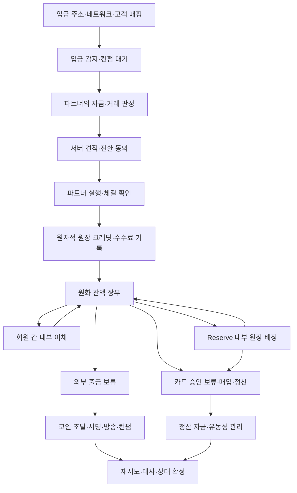

# 입출금과 백엔드 설계

작성일: 2026-10-13

## 1. 현재 PoC 구현

화면 순서, 지원 네트워크 예시, 수수료 및 취소 기준은 [입출금 흐름](funding-flows.md)에 정리했다.

홈의 `충전`은 `FundingDialog` 입금 모드를 연다. `보내기`는 `SendSheet`를 연다. 여기서 `Aqua 회원에게`(태그·이름·휴대폰 번호·이메일)나 `QR 코드 찍기`를 고르면, 시트 안에서 받는 사람 찾기 → 금액 → 확인을 거쳐 `SEND_TO_MEMBER`를 보낸다. 내 태그와 QR은 `ReceiveSheet`가 보여 준다. 태그 바꾸기(`SET_TAG`), 휴대폰 번호·이메일로 찾기 허용(`SET_FINDABLE`), 회원에게 받기 체험(`RECEIVE_FROM_MEMBER`)도 여기서 한다. `지갑 주소로`를 고르면 시트를 닫고 `FundingDialog` 출금 모드를 연다. `FundingDialog`는 코인·네트워크 선택, 입출금 정보 입력, 최종 확인과 처리 상세를 제공한다. `InternalTransferDialog`는 잔액과 리저브 사이의 이동을 입력·확인·완료로 나눈다. 진행 중인 요청은 홈의 입출금 상태 줄과 거래 내역의 `처리 내역`에서 다시 연다. 코인별 지갑이나 자산 화면은 없다.

`movements.ts`와 `engine.ts`는 `START_FUNDING` → 보류/대기 → 처리 → 완료·실패·취소를 모의 처리한다. 각 요청은 고유 키, 견적, 단계 시각, 실패 이유를 저장한다. 입금 완료 시 원화 스테이블 금액만 한 번 반영한다. 장부에는 코인 보유량이 없다. 출금 접수 시 잔액(`spend`)에서 총액을 예약하고, 완료 전에 실패하거나 취소하면 전액 반환한다. 처리 중 원금은 엔진의 총액(`portfolioValue`)에는 포함하지만 잔액과 카드로 쓸 수 있는 돈에서는 빠지고, 홈에 `보내는 중`으로 따로 보인다.

`SEND_TO_MEMBER`는 [directory.ts](../src/lib/directory.ts)의 가상 회원 태그를 찾아(앞의 `@`와 대소문자는 무시) 1,000원 이상 정수 금액을 잔액에서 바로 빼고, 거래 내역에 `transfer` 종류의 `김*지님에게 보냄`을 남긴다. 리워드와 리저브는 쓰지 않고, 수수료와 처리 중 상태가 없다. 받는 쪽 장부는 PoC에 없다.

- `findMemberByPhone`과 `findMemberByEmail`은 번호나 주소 전체가 맞는 회원만 돌려주고, 번호나 이메일이 없는(찾기를 끈) 회원은 찾지 않는다.
- 회원 간 보내기와 받기의 거래에는 상대 태그(`member`)를 남긴다. 받기는 잔액에만 더하고 거래 내역과 상세에서 `받기`로 보인다.
- 연간 거래 내역은 [statement.ts](../src/lib/statement.ts)의 `summarizeYear`가 거래와 입출금 요청, 결제를 한국 연도로 묶고, `statementText`가 탭으로 나눈 복사용 내역을 만든다.
- 계정의 태그(`account.tag`)는 가입 때 `initialTag`로 만든다. 태그가 없던 이전 저장 데이터는 불러올 때 같은 규칙으로 채운다.

입금 평가액은 `floor(수량 × 예시 시세)`이며 입금 전환 수수료는 없다. 출금의 전환 수수료는 원화 스테이블이 아닌 코인일 때만 `ceil(총액 × 0.005)`이고, 순 수령액은 `총액 - 전환 수수료 - 네트워크 비용`이다. 금액은 최소 1,000원이며 비용 공제 후 수령량이 양수여야 한다. 원화 계산은 십진수 비율과 정수 연산을 사용한다.

견적은 실제 시각 기준 30초 동안 신규 접수에 유효하다. 접수된 요청은 저장된 견적으로 계속 진행하며 견적 만료를 이유로 새로 차감하지 않는다. 하루 보상 체험 시계와 입출금 시계는 분리한다. 새로고침 시 지난 처리 단계를 이어서 반영한다. 기존 v1 저장 데이터에 작업 목록이 없는 경우 빈 목록을 추가해 보존한다.

입금 식별자는 실제 송금할 수 없는 `aqua-preview:` 형식이다. 주소 입력은 형식 검사만 수행한다. 출금 요청에는 받는 곳(`destination`: 목록의 거래소와 본인·다른 사람, 또는 내 지갑)을 남긴다. 엔진은 목록에 없는 거래소를 거절하지만, 내 지갑의 서명은 화면이 보낸 `proof: 'signature'` 표시만 확인한다. 실제 서버는 이 표시를 믿지 않고 아래 ⑧의 검증 기록으로 판단해야 한다. 본인 확인·수취인 인증·체인 이벤트·매매·서명·실제 전송을 실행하지 않는다. 과거의 즉시 반영·보유 코인 액션은 엔진에서 제거했고, 예전 저장 데이터의 보유 코인은 불러올 때 한 번 원화 스테이블로 전환한다. 브라우저 저장 데이터는 실제 금융 잔액의 신뢰 근거가 아니다.

## 2. 실제 백엔드에 필요한 처리 순서 (미구현)



### ① 입금 감지·확인

파트너가 발급·관리하는 지원 주소와 네트워크를 고객 계정에 매핑한다. 이벤트의 체인·거래 해시·출력/로그 인덱스 등을 식별자로 저장해 같은 입금을 중복 인식하지 않는다. 체인별 요구 컨펌 수, 재조직 처리, 지원 자산 여부, 트래블룰 및 자금 판정은 실제 파트너 정책으로 결정한다. 미확인·판정 대기 입금은 즉시 카드 사용 가능 잔액으로 만들지 않는다.

### ② 견적·동의·실행 확인

서버가 발급한 견적 ID에 자산·수량·받을 금액·가격·비용·만료·파트너를 묶는다. 사용자 입력의 가격이나 수수료를 그대로 신뢰하지 않는다. 해당 입금의 자동 전환 조건에 사전 동의가 있는지, 재견적에 추가 동의가 필요한지 확인한 뒤 파트너에 실행 요청한다.

견적은 체결이 아니다. `quote_created` → `authorized` → `execution_pending` → `execution_confirmed`를 구분한다. 만료·거절·부분 체결·실행 실패를 처리하고 **파트너가 확정한 순 수취 자금과 정산 가능 시점**을 기준으로 원장을 반영한다. 입력 자산 수량이 줄었다는 사실만으로 원화 정산 자금이 생겼다고 판단하지 않는다.

### ③ 원자적 이중 원장 반영

고객의 잔액 장부, Reserve, 보류 장부, 수수료, 파트너 정산 중간 계정을 분리한다. 각 전표는 식별자·통화·거래 출처·반대 기록을 가지며 차변/대변 합계가 맞아야 한다. 입금 체결 결과의 고객 크레딧과 수수료 분개는 한 데이터베이스 트랜잭션으로 반영한다. 같은 체결 이벤트를 재처리해도 고객 잔액이 다시 증가하지 않아야 한다.

예를 들어 체결로 확보한 원화 총액이 14,000원이면 고객 잔액 장부에 14,000원을 반영한다(입금 수수료 없음). 체결 비용이나 호가 차이는 Aqua 비용 계정이나 제휴 정산 계정에 따로 기록한다. 이는 단순한 제품 계산 예시이며 파트너 순수취액·세금·법정 회계 분개를 확정한 결과는 아니다. 실제 수수료 수익과 파트너 비용도 구분한다.

### ④ Reserve 내부 이동

원화 잔액 장부(`spend`)와 `reserve` 사이에서 원자적으로 옮긴다. 새 시장 매도·온체인 전송이 아니며 추가 전환비가 없다. 이동 시점에서 기존 적립 구간을 마감하고 새로운 적격 잔액으로 보상 산정을 시작한다.

Reserve 보상 장부는 고객 원금과 분리하고 지급 가능 혜택과 아직 적립 중인 값을 구분한다. 실제 고객 자산을 운용하는 경우 별도의 승인된 파트너 구조와 유동성 관리가 필요하다. Reserve라는 화면이 존재하는 것만으로 자산 운용이 수행되지 않는다.

### ⑤ 회원 간 보내기 (내부 이체)

태그는 회원 서비스에서 계정 식별자로 바꾼다. 휴대폰 번호 찾기는 회원이 허용했을 때, 번호 전체가 맞을 때만 응답하고 조회 횟수를 제한한다. 본인확인으로 받은 번호를 찾기에 써도 되는 동의 범위는 출시 전에 정한다. 보내는 사람에게는 받는 사람 이름의 첫 글자와 끝 글자만 보여 확인하게 한다. 보내는 회원의 잔액 차감과 받는 회원의 잔액 입금을 한 데이터베이스 트랜잭션으로 반영하고, 요청 키로 중복 전송을 막는다. 체인 전송이 없으므로 네트워크 비용과 처리 대기 상태가 없다. 탈퇴·정지 계정, 한도, 이상 거래 탐지와 잘못 보낸 돈의 처리, 회원 간 송금의 사업자 요건은 출시 전에 정한다.

### ⑥ 카드 승인·매입·취소·환불

카드 파트너의 승인 요청에서 사용 가능한 원금·리워드와 한도를 원자적으로 확인한다. 승인액을 **보류**하고 원금·리워드·Reserve 사용 구성을 저장한다. 매입/청산 이벤트에 따라 실제 차감·정산하고, 승인 취소·보류 만료·매입액 차이·부분 취소·환불을 각각 처리한다.

현재 PoC는 `PAY`에서 장부를 줄이고 `pending` 기록을 만들지만, 실제 시스템은 보류액과 가용액을 별도 관리해야 한다. 파트너 승인과 고객 장부 처리 사이에 실패하면 같은 거래를 중복 승인하거나 이중 차감하지 않는 복구가 필요하다. 환불은 원금과 리워드의 구성을 보존해 리워드가 현금성 원금으로 바뀌지 않도록 한다.

### ⑦ 정산 자금·유동성

**고객 원화 장부를 차감하는 것과 카드 가맹점에 지급할 실제 정산 자금을 확보하는 것은 다르다.**

일반 결제대금의 경제적 원천은 사용자 자금이다. 하지만 그 자금이 코인, 전환 미정산금, 운용 자산, 특정 통화나 특정 파트너 계정에 있으면 카드 정산 시점에 필요한 법정화폐 자금이 즉시 사용 가능하다는 뜻이 아니다. 실제 Treasury는 통화별 현금/정산 계정, 파트너 예치 요구액, 미정산 거래, 외부 출금, Reserve 인출 가능액을 함께 관리해야 한다.

리워드 사용분은 원금에 추가하는 혜택이므로 회사·제휴사의 보상 재원이 필요하다. 카드 승인에서 원금 8,000원과 리워드 2,000원으로 결제해도 가맹점 지급액은 10,000원이다. 리워드 2,000원을 고객 원금에서 추가 차감하는 구조로 이를 해결하지 않는다.

### ⑧ 외부 출금 상태와 복구

출금(지갑 주소로 보내기)은 잔액에서만 요청하고, Reserve 원금은 먼저 잔액으로 옮긴다. 서버 견적에서 전환비·실제 네트워크 비용·최소액·예상 수령량을 구분한다. 요청 승인 때 총액을 보류한 뒤 조달·서명·방송·컨펌까지 상태를 추적한다.

```text
requested → approved → funds_held → execution_confirmed
          → signing → broadcast → confirming → completed
```

#### 받는 곳 확인(트래블룰)

Aqua는 수탁형이다. 고객 잔액과 출금에 쓰는 코인은 Aqua(또는 수탁 파트너)가 보관하고, 출금 거래는 승인 뒤 Aqua의 수탁 지갑이 서명해 방송한다. 고객이 하는 `서명하기`는 출금 거래 서명이 아니라 **받는 개인지갑이 본인 것임을 증명하는 메시지 서명**이다. 돈은 움직이지 않는다. 거래소 계정으로 보낼 때는 받는 쪽 지갑이 거래소 소유라 서명할 수 없으므로, 대신 트래블룰로 사업자끼리 이름과 주소를 주고받는다.

- **내 지갑 확인 순서:**
  1. 서버가 확인 문구를 발급한다. 고객 ID, 주소, 네트워크, 일회용 값(nonce), 만료 시각을 묶는다.
  2. 고객이 그 지갑으로 문구에 서명한다.
  3. 서버가 서명에서 주소를 복원해 받는 주소와 같은지, nonce가 처음 쓰였고 만료 전인지 확인한다.
  4. 확인한 주소를 고객의 `내 지갑` 목록에 남긴다(주소, 네트워크, 방법, 서명 원문, 확인 시각). 다음 출금부터는 목록에서 고르게 하고, 기록은 거래관계 종료 뒤 5년 보관한다.
  5. 출금 API는 `own_wallet` 요청을 이 목록에 있는 주소로만 받는다.
- **주소 종류별 검증:**
  - 이더리움 계열 일반 주소(EOA): EIP-191 서명에서 주소를 복원한다.
  - 스마트 계약 지갑(Safe 등): 복원이 안 되므로 EIP-1271 `isValidSignature`를 체인에 물어본다. 체인마다 배포 여부가 달라 네트워크별로 확인한다.
  - 비트코인: BIP-322 메시지 서명(탭루트 포함)이나 그 이전 방식(BIP-137)이다. BIP-322를 지원하지 않는 지갑이 많다.
  - 서명이 안 되는 지갑에는 소액 이전 확인을 둔다. 그 지갑에서 정해진 소액을 Aqua 입금 주소로 보내게 해 통제권을 확인한다.
- **거래소로 보낼 때:** 방송 전에 트래블룰 망(CODE·VerifyVASP)으로 보내는 사람·받는 사람 정보를 보내고 받는 사업자의 수락을 기다린다. 이름이 맞지 않아 거절되면 방송하지 않고 보류를 푼다. 이미 방송한 뒤 반환되면 입금으로 다시 처리한다.
- **공통:** 방송 전에 받는 주소를 블록체인 분석으로 검사하고, 미신고 사업자나 제재 명단에 걸리면 보류한다. 고객에게는 사유를 자세히 알리지 않는다(의심거래보고 누설 금지).

확정 전 실패·보류·거절도 별도 기록한다. 전송 응답이 유실되면 거래 해시와 파트너 상태를 조회하고 이미 방송한 거래를 다시 보내지 않는다. 방송 전 확정 실패라면 정책에 따라 보류를 해제하고, 이미 매수·체결되었으면 해당 자금과 비용의 복구를 별도 처리한다. 입금·매매·서명·파트너 웹훅·DB 처리에는 각각 멱등 키와 재시도 정책이 필요하다.

### ⑨ 대사

블록체인/수탁사의 자산 수량, 매매 파트너 체결·정산, 원장 전표, 회원 간 이체의 양쪽 기록, 카드 승인·매입·환불, 은행/정산 계정, 외부 출금 상태를 주기적으로 대사한다. 차이를 경고하고 원인을 조사하는 동안 영향받는 거래를 보류할 수 있어야 한다. 앱의 합계가 맞는 것만으로 자산 실재나 외부 정산 완료가 증명되지 않는다.

## 3. 검증 범위

`movements.test.ts`와 `engine.test.ts`에서 보류액과 총액, 최소액·비용·정밀도, 중복 접수·완료·취소, 실패와 재접수, 기존 데이터 이전, 새로고침 후 진행, 회원 보내기의 태그·휴대폰 번호·이메일 찾기, 받기, 태그 바꾸기 규칙과 거절 조건, `statement.test.ts`에서 연간 요약과 복사 내역을 확인한다. 브라우저 검증은 실제 화면의 입력·최종 확인·상태 상세·실패 복구와 작은 화면을 확인한다. 실행 방법과 결과는 [테스트 안내](testing.md)에 기록한다.

실제 파트너 연동에는 입금 이벤트 중복·체인 재조직, 동시 승인, 부분 체결, 웹훅 순서 역전, 방송 후 응답 유실, 대사 차이와 복구를 별도로 검증해야 한다.
