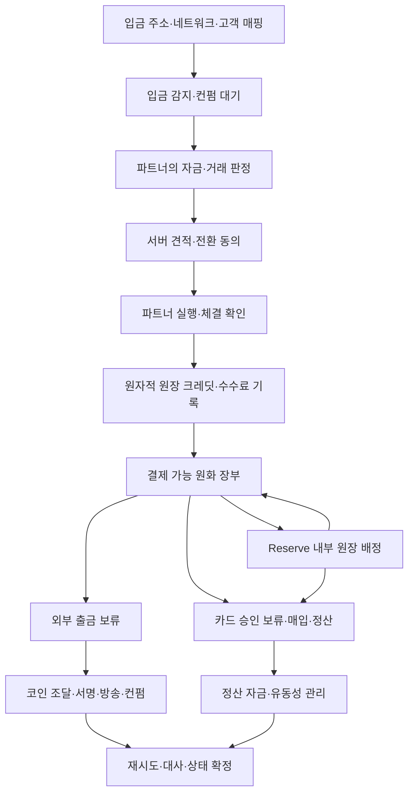

# Aqua Card 자금 구조: 현재 PoC와 실제 백엔드 계획

작성일: 2026-10-13 · 현재 구현: 브라우저 모의 장부 · 후속 설계: 파트너 연동 백엔드

**현재 앱은 코인 입금을 원화 결제 자금으로 바꾸는 경험을 모의 구현했다. 실제 코인 입금 감지·매매·수탁·카드 정산·외부 송금은 실행하지 않는다.** 원화 결제 잔액과 Reserve는 앱 안의 원화 장부이며, 새로 발행한 원화 스테이블코인이 아니다.

[KAST 공식 약관 확인](kast-funding-model.md)에 따라 **입금 자산의 자금화**와 **Reserve 내부 배정**을 구분한다. KAST의 USD 채권 장부 계약을 한국 서비스에 그대로 적용하는 것은 별도 결정이며, 한국의 제공 주체·소유권·보관·전환 계약은 실제 파트너와 정해야 한다.

## 1. 현재 구현된 브라우저 PoC

| 기능 | 코드와 현재 동작 | 실제로 수행하지 않는 일 |
| --- | --- | --- |
| 입금 견적 | `src/lib/funding.ts`의 `getFundingQuote({ direction: 'receive' })`, 고정 데모 시세·전환비 계산 | 실시간 유동성 공급자 견적·체결 |
| 신규 코인 입금 | `RECEIVE_ASSET`: 입금 수량의 순 원화액을 `spend`에 더하고 거래 기록 생성 | 블록체인 감지·주소 발급·실제 매도 |
| 출금 견적 | `getFundingQuote({ direction: 'withdraw' })`, 원화 총액·전환비·예상 코인 수량 계산 | 실제 코인 매수·네트워크 비용 조회 |
| 코인 출금 모의 | `WITHDRAW_CRYPTO`: `spend`에서 원화 총액을 빼고 예상 수령량을 거래 기록에 표시 | 지갑 서명·외부 송금·컨펌 |
| Reserve 배정 | `TRANSFER_RESERVE`: `spend`와 `reserve` 사이의 원화 장부 이동, 수수료 0원 | 코인 재매도·별도 온체인 전송·자산 운용 |
| 카드 결제 | `PAY`: 리워드 → 결제 잔액 → 허용된 Reserve 순으로 차감하고 `pending` 결제 기록 | 발급사 승인 API·카드망·은행 정산 |
| 결제 확정·환불 | `CONFIRM_PAYMENT`·`REFUND`: 모의 상태·페이백·원금/리워드 복원 처리 | 외부 가맹점 매입·실제 환불·차지백 |
| 장부 저장 | 브라우저 상태와 로컬 저장 데이터 | 서버 데이터베이스·이중 원장·다중 기기 동기화 |

핵심 파일은 [`funding.ts`](../src/lib/funding.ts), [`engine.ts`](../src/lib/engine.ts), [`policy.ts`](../src/lib/policy.ts), [`types.ts`](../src/lib/types.ts)다. 브라우저 데이터는 사용자가 변경·삭제할 수 있으므로 실제 금융 잔액의 신뢰 근거로 사용할 수 없다.

### 신규 입금의 금액 계산

```text
grossWon = floor(입금 수량 × 고정 데모 시세)
feeWon   = ceil(grossWon × 0.005)
netWon   = grossWon − feeWon
spend    = 기존 spend + netWon
```

- BTC·ETH·USDT·USDC가 대상이다. 예시 시세는 실제 시장가격이 아니다.
- 십진수 입력의 비율을 `BigInt`로 계산해 이진 부동소수점 곱셈의 원 단위 오차를 피한다.
- 입금 총평가액은 최소 1,000원이다. 수수료 공제 후 순액이 1,000원 미만일 수 있다.
- 수수료 0.5%는 Aqua의 자체 모의 정책이며 KAST의 공식 전환비가 아니다.
- **신규 입금 수량을 `holdings`에도 더하지 않는다.** 같은 입금이 코인 보유량과 원화 장부에 중복 반영되지 않게 한다.

10 USDC × 데모 시세 1,400원 = 평가액 14,000원, 수수료 70원, 원화 결제 잔액 증가 13,930원이다. 이 입금을 Reserve로 10,000원 배정해도 추가 전환비는 없고 결제/Reserve 합계는 그대로다.

### 출금의 금액 계산

```text
grossWon   = 사용자가 선택한 출금 원화 총액
feeWon     = ceil(grossWon × 0.005)
netWon     = grossWon − feeWon
outputUnits = netWon / 고정 데모 시세
spend       = 기존 spend − grossWon
```

- 출금 원화 총액은 1,000원 이상의 안전한 정수여야 한다.
- `spend`가 총액보다 적으면 실패한다. **리워드·Reserve·기존 코인 보유량으로 출금 부족분을 자동 충당하지 않는다.**
- Reserve 원금을 출금하려면 먼저 `reserve` → `spend` 내부 이동을 한다.
- 모의 외부 출금은 기존 `holdings`에서 같은 코인 수량을 빼는 동작이 아니다. 원화 장부를 대상으로 수령 코인 예상량을 계산한다.
- 네트워크 비용은 미반영이며 실제 외부 전송은 없다. 0.5% 전환비는 모의 장부 금액에 반영한다.

14,000원 출금은 전환비 70원을 제외한 13,930원 / 1,400원 = 9.95 USDT 예상이다. 1,001원 출금은 수수료를 올림한 6원, 순액 995원이다. 입금 때와 출금 때 각각 전환 비용이 있으므로 입출금 왕복이 원금 그대로 돌아오는 구조가 아니다.

### 견적·실패 경계

`assertFundingQuoteFresh`는 견적 시각이 실제 시간 기준 **30초까지** 유효한지 검증한다. 정확히 30,000ms는 통과하고 30,001ms는 실패한다. 미래 시각·음수·NaN·무한대도 실패한다. 데모의 하루 진행 시계는 견적 만료 시간을 바꾸지 않는다.

원화 안전 정수 초과, 잘못된 자산·수량·금액·견적, 잔액 부족에서 거래를 중단한다. 엔진은 상태를 복사한 뒤 처리하므로 실패한 새 입출금의 원금·리워드·누적 적립·거래 기록이 원래 상태에 부분 반영되지 않는다.

현재 견적에는 서버 ID·서명·실제 체결 보장이 없다. 브라우저의 시각 검증은 제품 데모를 위한 경계 처리다. 외부 웹훅 중복 수신이나 여러 기기에서 동시에 요청하는 문제를 해결하는 금융 백엔드가 구현된 것은 아니다.

### 기존 코인 보유 데이터

이전 PoC의 `holdings`와 `DEPOSIT_ASSET`·`WITHDRAW_ASSET`·`CONVERT` 경로는 기존 모의 보유 데이터를 보존하기 위해 남아 있다. 신규 자동 자금화 입금과 별도다. 기존 원물 평가액을 Reserve 보상 원금이나 바로 쓸 카드 잔액으로 합산하지 않는다. 실제 제공 범위는 UI와 후속 파트너 구조에 맞춰 별도로 정한다.

## 2. 실제 백엔드에 필요한 처리 순서 — 아직 미구현



### ① 입금 감지·확인

파트너가 발급·관리하는 지원 주소와 네트워크를 고객 계정에 매핑한다. 이벤트의 체인·거래 해시·출력/로그 인덱스 등을 식별자로 저장해 같은 입금을 중복 인식하지 않는다. 체인별 요구 컨펌 수, 재조직 처리, 지원 자산 여부, 트래블룰 및 자금 판정은 실제 파트너 정책으로 결정한다. 미확인·판정 대기 입금은 즉시 카드 사용 가능 잔액으로 만들지 않는다.

### ② 견적·동의·실행 확인

서버가 발급한 견적 ID에 자산·수량·받을 금액·가격·비용·만료·파트너를 묶는다. 사용자 입력의 가격이나 수수료를 그대로 신뢰하지 않는다. 해당 입금의 자동 전환 조건에 사전 동의가 있는지, 재견적에 추가 동의가 필요한지 확인한 뒤 파트너에 실행 요청한다.

견적은 체결이 아니다. `quote_created` → `authorized` → `execution_pending` → `execution_confirmed`를 구분한다. 만료·거절·부분 체결·실행 실패를 처리하고 **파트너가 확정한 순 수취 자금과 정산 가능 시점**을 기준으로 원장을 반영한다. 입력 자산 수량이 줄었다는 사실만으로 원화 정산 자금이 생겼다고 판단하지 않는다.

### ③ 원자적 이중 원장 반영

고객의 결제 장부, Reserve, 보류 장부, 수수료, 파트너 정산 중간 계정을 분리한다. 각 전표는 식별자·통화·거래 출처·반대 기록을 가지며 차변/대변 합계가 맞아야 한다. 입금 체결 결과의 고객 크레딧과 수수료 분개는 한 데이터베이스 트랜잭션으로 반영한다. 같은 체결 이벤트를 재처리해도 고객 잔액이 다시 증가하지 않아야 한다.

예를 들어 체결로 확보한 원화 총액이 14,000원이고 별도 비용이 없다는 가정에서 고객 결제 장부 13,930원과 전환비 기록 70원을 동시에 반영한다. 이는 단순한 제품 계산 예시이며 파트너 순수취액·세금·법정 회계 분개를 확정한 결과는 아니다. 실제 수수료 수익과 파트너 비용도 구분한다.

### ④ Reserve 내부 이동

결제 가능 원화 장부를 `spend`에서 `reserve`로 또는 반대로 원자적으로 옮긴다. 새 시장 매도·온체인 전송이 아니며 추가 전환비가 없다. 이동 시점에서 기존 적립 구간을 마감하고 새로운 적격 잔액으로 보상 산정을 시작한다.

Reserve 보상 장부는 고객 원금과 분리하고 지급 가능 혜택과 아직 적립 중인 값을 구분한다. 실제 고객 자산을 운용하는 경우 별도의 승인된 파트너 구조와 유동성 관리가 필요하다. Reserve라는 화면이 존재하는 것만으로 자산 운용이 수행되지 않는다.

### ⑤ 카드 승인·매입·취소·환불

카드 파트너의 승인 요청에서 사용 가능한 원금·리워드와 한도를 원자적으로 확인한다. 승인액을 **보류**하고 원금·리워드·Reserve 사용 구성을 저장한다. 매입/청산 이벤트에 따라 실제 차감·정산하고, 승인 취소·보류 만료·매입액 차이·부분 취소·환불을 각각 처리한다.

현재 PoC는 `PAY`에서 장부를 줄이고 `pending` 기록을 만들지만, 실제 시스템은 보류액과 가용액을 별도 관리해야 한다. 파트너 승인과 고객 장부 처리 사이에 실패하면 같은 거래를 중복 승인하거나 이중 차감하지 않는 복구가 필요하다. 환불은 원금과 리워드의 구성을 보존해 리워드가 현금성 원금으로 바뀌지 않도록 한다.

### ⑥ 정산 자금·유동성

**고객 원화 장부를 차감하는 것과 카드 가맹점에 지급할 실제 정산 자금을 확보하는 것은 다르다.**

일반 결제대금의 경제적 원천은 사용자 자금이다. 하지만 그 자금이 코인, 전환 미정산금, 운용 자산, 특정 통화나 특정 파트너 계정에 있으면 카드 정산 시점에 필요한 법정화폐 자금이 즉시 사용 가능하다는 뜻이 아니다. 실제 Treasury는 통화별 현금/정산 계정, 파트너 예치 요구액, 미정산 거래, 외부 출금, Reserve 인출 가능액을 함께 관리해야 한다.

리워드 사용분은 원금에 추가하는 혜택이므로 회사·제휴사의 보상 재원이 필요하다. 카드 승인에서 원금 8,000원과 리워드 2,000원으로 결제해도 가맹점 지급액은 10,000원이다. 리워드 2,000원을 고객 원금에서 추가 차감하는 구조로 이를 해결하지 않는다.

### ⑦ 외부 출금 상태와 복구

출금은 결제 가능 원금에서만 요청하고, Reserve 원금은 먼저 결제 장부로 이동한다. 서버 견적에서 전환비·실제 네트워크 비용·최소액·예상 수령량을 구분한다. 요청 승인 때 총액을 보류한 뒤 조달·서명·방송·컨펌까지 상태를 추적한다.

```text
requested → approved → funds_held → execution_confirmed
          → signing → broadcast → confirming → completed
```

확정 전 실패·보류·거절도 별도 기록한다. 전송 응답이 유실되면 거래 해시와 파트너 상태를 조회하고 이미 방송한 거래를 다시 보내지 않는다. 방송 전 확정 실패라면 정책에 따라 보류를 해제하고, 이미 매수·체결되었으면 해당 자금과 비용의 복구를 별도 처리한다. 입금·매매·서명·파트너 웹훅·DB 처리에는 각각 멱등 키와 재시도 정책이 필요하다.

### ⑧ 대사

블록체인/수탁사의 자산 수량, 매매 파트너 체결·정산, 원장 전표, 카드 승인·매입·환불, 은행/정산 계정, 외부 출금 상태를 주기적으로 대사한다. 차이를 경고하고 원인을 조사하는 동안 영향받는 거래를 보류할 수 있어야 한다. 앱의 합계가 맞는 것만으로 자산 실재나 외부 정산 완료가 증명되지 않는다.

## 3. 이번 검증과 후속 검증

`src/lib/engine.test.ts`의 자금 관련 테스트를 선별해 **9개 실행·9개 통과**했다. 확인한 범위는 다음과 같다.

- 신규 입금 수수료와 순 원화 반영, 기존 코인 보유량의 비중복.
- 원화 잔액 출금과 예상 수령량, 리워드·Reserve의 자동 출금 사용 차단.
- 십진수 평가액·원 단위 절사·수수료 올림.
- 최소액·지원 자산·유한 수량·안전 정수 범위.
- 실제 시간의 30초 견적 경계, 미래/잘못된 시각과 실패 원자성.
- Reserve 배정·해제의 자산 가치 보존·추가 매도/수수료 없음.
- 기존 모의 코인 보유 경로의 전환 비용 반영.

이는 이번 문서 작업에서 실행한 단위 검증 결과다. 실제 파트너·체인·카드망·은행·백엔드 검증 결과가 아니다. 향후 실제 구현에는 입금 이벤트 중복/체인 재조직, 동시 승인, 부분 체결, 웹훅 순서 역전, 방송 후 응답 유실, 대사 차이와 복구를 검증하는 통합 테스트가 필요하다.
