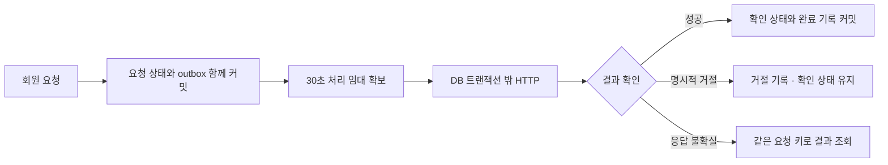

# 발급사 카드 상태 요청과 복구

`006_issuer_outbox.sql`은 테스트 발급사 카드의 잠금·해제 요청을 PostgreSQL outbox로 전달한다. 회원의 요청 상태와 전송할 명령을 한 트랜잭션에 저장하고, 별도 작업자가 DB 트랜잭션 밖에서 HTTP를 호출한다. 현재 어댑터는 **Aqua 자체 sandbox 규격**이다. Reap의 API 계약이나 실제 카드 잠금 기능을 구현한 것이 아니다.

[연결 웹 화면의 카드 설정](card-controls-ui.md)은 이 API로 요청 상태와 확인 상태를 구분한다. 007 이후 [새 결제 승인 정책](card-authorization-policy.md)은 회원당 한 장의 카드 매핑을 사용해 잠금 요청 접수부터 테스트 원장 새 승인을 차단한다. 실제 발급사의 실시간 승인 계약은 아직 연결하지 않았다.

## 요청 상태와 확인 상태

회원별 sandbox 카드 매핑은 운영자 명령으로 등록한다. 공급업체 참조는 `sandbox-card-`로 시작하는 테스트 식별자만 허용하고 카드번호·보안 코드는 저장하지 않는다. 등록의 초기 상태는 운영자가 제공한 테스트 전제이며 공급업체 조회로 확인한 상태가 아니다.

`desiredStatus`는 가장 최근에 요청한 `active` 또는 `locked`다. `confirmedStatus`는 초기 등록 상태 또는 공급업체가 성공을 확인한 상태다. 잠금 요청을 저장했을 때 `desiredStatus`만 바뀐다. HTTP 202를 잠금 완료로 표시하면 안 된다. 거절되거나 결과가 불확실하면 확인 상태를 바꾸지 않는다.

카드당 미해결 명령은 하나만 허용한다. 잠금 결과를 모르는 상태에서 해제를 요청하면 409로 거절한다. 버전 확인은 오래된 화면의 변경을 막으며, 같은 회원의 같은 요청 키·내용 재전송은 최초 접수 결과를 반환한다. 같은 키로 내용을 바꾸면 충돌이다.

| API | 계약 |
| --- | --- |
| `GET /api/issuer-card` | 세션과 일치하는 `X-Aqua-Account` 필수. 매핑이 없으면 `card: null`. `canRequestStatus`로 변경 허용 여부를 반환하며 공급업체 참조·전송 키·작업 임대 토큰은 제외. |
| `POST /api/issuer-card/status` | 본문은 `cardId`, `targetStatus`, `expectedVersion`만 허용. 세션과 일치하는 `X-Aqua-Account`, 8~128자의 `Idempotency-Key`, 허용된 Origin이 필요. |

변경은 회원별 분당 20회로 제한한다. 카드 소유권·버전·미해결 요청을 DB에서 다시 검사한다. 요청 키는 성공·실패를 확신할 수 없을 때도 새로 만들지 않는다. 운영 모드에서 sandbox 변경 API는 403이며, 조회는 `mode: sandbox`를 포함한다.

## 전송과 결과 불확실성



작업자는 UUID 임대 토큰과 증가하는 버전으로 명령을 확보한다. 다른 작업자는 같은 임대를 사용할 수 없다. 만료되거나 교체된 작업자의 늦은 응답은 DB에 반영하지 않는다. 결과 기록 후 응답만 유실된 경우에는 같은 완료 입력으로 최초 결과를 다시 받을 수 있다.

프로세스가 중단되면 30초 임대가 끝난 뒤 다른 작업자가 이어받는다. 이어받은 작업은 **조회부터 수행**한다. 타임아웃·연결 종료·5xx·일반 404·잘못된 응답도 미실행의 증거가 아니므로 조회로 전환한다. 정확한 요청 키를 포함한 권위 있는 `not_found` 응답을 받았을 때만 같은 명령을 재전송할 수 있다.

최초 요청 생성 시 재전송 기한을 24시간 뒤로 고정한다. 운영자 재시도로 기한을 늘리거나 공급업체 요청 키를 바꾸지 않는다. 기한 이후에는 결과 조회만 가능하며, 확인되지 않으면 검토 상태를 유지한다. 재전송 본문에도 고정된 `expiresAt`을 넣고 서명한다.

이 안전성에는 공급업체 계약이 필요하다. sandbox 상대는 같은 요청 키의 최초 실행을 원자적으로 중복 방지하고, 내용이 다른 재사용을 거절하며, 명령 결과를 최초 실행 후 최소 24시간 보존해야 한다. 처음 도착한 명령이 `expiresAt`을 지났다면 실행을 거절해야 한다. DB의 임대 토큰만으로 이미 나간 HTTP 요청을 취소할 수는 없다. 실제 발급사가 이 보장을 제공하는지 확인하기 전에는 이 어댑터를 운영용으로 바꿀 수 없다.

## 재시도와 운영자 복구

| 상태 | 의미 |
| --- | --- |
| `pending` | 요청과 전송 내용 저장 완료 |
| `in_flight` | 한 작업자가 임대를 확보함. 외부 실행 여부는 아직 미확정 |
| `retry` | 전송 또는 결과 조회를 예약함 |
| `succeeded` | 공급업체가 같은 명령의 성공을 확인함 |
| `failed` | 공급업체가 명시적으로 거절함 |
| `needs_review` | 자동 처리 중지. 확인되지 않은 명령은 후속 요청을 계속 막음 |

한 주기는 최대 8번의 **커밋된 임대 확보**를 허용한다. 확보 후 프로세스가 종료된 경우도 횟수에 포함한다. 재시도 간격은 1초, 5초, 15초, 1분, 5분, 15분, 1시간이다. 수신 inbox의 실패 시도 횟수와 의미가 다르다.

운영자 복구는 `needs_review`에만 허용한다. 현재 명령 버전·작업 키·10~500자의 사유가 필요하며 DB 로그인 역할과 변경 이력을 남긴다. 총 시도 횟수·공급업체 키·만료 시각은 유지하고 주기 횟수만 초기화한다. 복구도 조회부터 시작한다. 성공을 임의로 선언하거나 새로운 키로 우회 전송하는 명령은 없다.

## 로컬 실행

기존 DB 볼륨에는 새 로컬 역할을 추가하고 `.env.example`의 `DATABASE_DISPATCHER_ROLE`, `DISPATCHER_DATABASE_URL`을 개인 `.env`에 반영한다. 기존 역할·데이터를 덮어쓰지 않는다.

```bash
docker compose exec -T postgres psql -U aqua -d aqua -v ON_ERROR_STOP=1 < docker/postgres-init.sql
DATABASE_DISPATCHER_ROLE=aqua_dispatcher npm run db:migrate
npm run server:issuer -- register USER_ID sandbox-card-local active
npm run server:issuer -- status USER_ID
npm run server:issuer -- request USER_ID CARD_UUID locked CARD_VERSION local-lock-001
npm run server:issuer -- inspect COMMAND_UUID
npm run server:issuer -- status
npm run server:issuer -- retry COMMAND_UUID COMMAND_VERSION RETRY_KEY '공급업체 명령 조회를 확인한 뒤 다시 처리'
```

`register`·`status`·`inspect`·`retry`는 명시적인 `MIGRATION_DATABASE_URL`을 사용한다. `request`는 제한된 API의 `DATABASE_URL`을 사용하며 로컬 테스트용이다. 일반 회원은 세션이 확인되는 API로 요청한다. 운영 모드에서 CLI는 조회만 허용한다. `inspect`는 읽기 전용의 일관된 시점에서 상태·버전·횟수·기한과 최근 처리·복구 이력을 각각 최대 100개 반환한다. 전송 본문·요청 키·임대 토큰·비밀값은 제외한다.

발신 작업자는 `DISPATCHER_DATABASE_URL`만 사용한다. API·수신·원장 작업자의 계정을 대신 사용하지 않는다. 명령 확보·완료·집계 함수와 마이그레이션 이력 조회만 허용하며 회원 조회, 명령 생성, 카드 등록, 원장 변경, 운영자 복구를 할 수 없다. API도 전송 큐나 공급업체 참조를 직접 조회·수정할 수 없다. 런타임 역할은 다른 DB 역할의 membership을 가질 수 없다. `NOINHERIT`·`SET FALSE`여도 membership 관리 권한으로 역할 전환을 다시 허용할 수 있으므로, 시작 시 membership 자체를 거절한다.

`AQUA_ISSUER_SANDBOX_URL`, `AQUA_ISSUER_KEY_ID`, `AQUA_ISSUER_SIGNING_KEY`를 명시적으로 설정한 뒤 실행한다. URL은 포트가 있는 `http://127.0.0.1:PORT` 또는 `http://[::1]:PORT`만 허용한다. 기본 비밀값은 없다. 키는 난수 32바이트를 패딩 없는 base64url로 인코딩한다. 저장소나 브라우저 환경 변수에 넣지 않는다.

```bash
npm run server:issuer:dispatch -- --once
npm run server:issuer:dispatch
```

현재 공급업체 테스트 서버는 자동으로 배포하지 않는다. 통합 검사는 로컬 HTTP 상대를 만들어 프로세스 재시작과 응답 유실을 재현한다. 실제 Reap URL이나 자격 증명을 넣는 방식으로 사용할 수 없다. 운영 모드에서는 어댑터 생성과 작업자 실행을 거절한다.

작업자는 기본 1초 간격으로 대기하며 `AQUA_ISSUER_POLL_MS`로 250~60,000ms 범위에서 설정한다. SIGTERM·SIGINT에는 새 작업을 멈추고 현재의 제한된 HTTP 처리·결과 저장을 마친 뒤 종료한다. `--once`는 처리 결과를 먼저 출력한 뒤 전체 큐 상태를 확인한다. 전체 큐에 검토 건이 하나라도 있으면 2, 처리·상태 확인 실패면 1, 그 외에는 0으로 종료한다. 임대 확보 중 검토로 전환된 건도 집계에 반영되므로 결과가 `null`이라고 큐가 비었다는 뜻은 아니다. DB 접속 실패는 최대 30초 간격으로 재시도한다. 분당 `issuer_outbox_health`와 처리 메타데이터를 로그로 남기며 원문·서명·전송 키·임대 토큰을 출력하지 않는다.

컴파일한 진입점은 `node dist-server/issuer-dispatcher.js`다. 공통 Docker 이미지의 API용 `HEALTHCHECK`를 작업자에 적용하지 않도록 `--no-healthcheck` 또는 배포 설정에서 비활성화해야 한다. 대기 시간, 검토 건수와 작업자 로그 중단에 대한 운영 알림은 별도로 연결해야 한다.

## Sandbox HTTP 계약

`POST /cards/CARD_REF/status`는 `{requestKey,cardRef,targetStatus,expiresAt}`를 전송하고 `Idempotency-Key`에도 같은 요청 키를 넣는다. 조회는 `GET /operations/REQUEST_KEY`다. HMAC-SHA256의 입력은 `sandbox.issuer.v1.KEY_ID.TIMESTAMP.METHOD.PATH.`의 UTF-8 바이트와 JSON 본문 바이트다. GET 본문은 없다. `x-aqua-key-id`, Unix 초의 `x-aqua-timestamp`, `v1=`과 소문자 16진수 서명의 `x-aqua-signature`를 전송한다. 상대 서버는 서명과 전송 시각을 검증해야 한다.

| 결과 | 허용 응답 |
| --- | --- |
| 성공 | 200, `{requestKey,cardRef,status:"succeeded",cardStatus:요청한상태}` |
| 거절 | 전송 422 또는 조회 200, `{requestKey,cardRef,status:"rejected",code}`. code는 `CARD_NOT_FOUND`, `CARD_CLOSED`, `COMMAND_REJECTED`만 허용 |
| 처리 중 | 202, `{requestKey,cardRef,status:"pending"}` |
| 실행 기록 없음 | 조회 404, `{requestKey,status:"not_found",authoritative:true}`만 허용 |

요청 키·카드·성공 상태가 맞지 않거나 추가·중복 필드가 있으면 확인된 결과로 받아들이지 않는다. 리디렉션을 따르지 않고 압축 응답을 거절한다. UTF-8 JSON 응답은 최대 8KiB, 요청과 본문 수신을 합친 제한 시간은 5초다. 외부 오류 원문은 저장하거나 로그에 노출하지 않는다.

## 검증과 남은 연결

2026-11-19 기준 신규 검사 47개가 통과했다. 구성은 원장과 분리된 outbox의 PostgreSQL 검사 19개, HTTP 어댑터·작업자 제어 16개, 회원 API 6개, 실제 발신·권한·운영자 CLI 프로세스 검사 6개다. 기존 서버 검사 139개와 제품 로직 127개도 통과했다. 서버·연결 웹 빌드와 로컬 DB 내부 대사를 확인했다.

실제 PostgreSQL 테스트에서 상태·명령의 원자적 기록, 동시 요청, 임대 회수, 늦은 응답 차단, 기한과 감사 이력을 검사한다. 실제 HTTP 상대와 별도 작업자 프로세스로 전송 후 응답 유실·재시작·조회 복구를 확인한다. 이때 금전 원장은 바뀌지 않는다.

실제 발급사 카드 발급·본인확인·상태 조회 계약, 실시간 승인과 잠금 정책 연결, 운영 승인 절차·관측·부하·복구 검증은 남아 있다. 이 작업이 실제 카드 발급이나 운영 배포를 뜻하지 않는다.

### 샌드박스 카드 신청과 발급

이메일 확인과 고객 승인을 마친 회원은 등록된 카드가 없을 때 연결형 카드 화면에서 가상·실물 카드를 신청할 수 있다. 심사, 발급, 배송 이벤트는 발급 시뮬레이터 전용 로그인(`ISSUANCE_DATABASE_URL`)으로 처리한다. 명령에는 직전 처리 결과의 버전을 넣는다.

```sh
npm run server:issuance -- "$application_id" 1 review-001 approve
npm run server:issuance -- "$application_id" 2 issue-001 issue
```

가상 카드는 발급 직후 신청자가 활성화할 수 있다. 실물 카드는 `dispatch`, `deliver` 순서로 배송을 확인한 뒤 활성화한다. 신청을 반려할 때는 `decline ELIGIBILITY` 또는 `decline DETAILS_REQUIRED`를 사용한다. 처리 결과를 받지 못하면 원래 이벤트 ID, 버전과 내용으로 재시도한다. 활성화가 끝나면 샌드박스 카드 한 장이 등록되고 카드 설정에서 잠금·해제를 요청할 수 있다. 운영 모드에서는 모의 발급을 차단한다.
