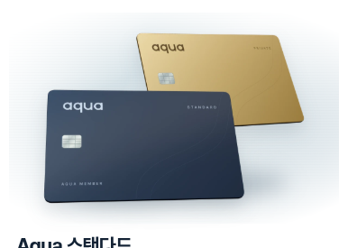
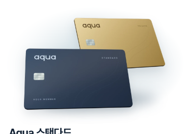

# Aqua Card 제품·개발 검토

2026년 11월 27일, 은행 입출금 대사까지 들어간 PR #34의 `3f11f79`을 기준으로 검토했다. 홈·혜택은 공개 PR #26 미리보기와 같은 소스다. 돈과 카드가 브라우저에 저장되는 체험판과 PostgreSQL의 `TEST_KRW`를 쓰는 연결판은 구현 범위가 다르다. 아래의 금액은 합성 거래다. [공개 미리보기](https://sohw400.github.io/aquacard/preview/pr-26/) · [기준 PR](https://github.com/sohw400/aquacard/pull/34)

## 홈과 카드 결제

**리저브는 회원이 따로 둔 원금이고, 리워드는 카드 결제에 쓸 수 있는 보상 잔액이다.** 페이백은 카드 결제로 생기는 리워드의 한 종류다. 리저브 보상도 리워드에 쌓인다. ‘리워드 우선 사용’을 끄면 체험판은 리워드를 결제 재원에서 완전히 제외한다. 리워드를 적립하는 기능은 계속 동작한다. [결제 차감 순서](../src/lib/engine.ts) · [혜택 화면](../src/pages/Benefits.tsx)

카드가 활성 상태이고 다른 제한을 충족한다고 가정했다. 지갑에 7,000원, 리워드에 3,000원, 리저브에 9,000원이 있을 때 12,000원을 결제한 결과다.

| 카드 결제에 리워드 사용 | 지갑 부족분을 리저브에서 결제 | 결과 |
| --- | --- | --- |
| 끔 | 끔 | 5,000원 부족. 차감 없음 |
| 켬 | 끔 | 2,000원 부족. 차감 없음 |
| 끔 | 켬 | 지갑 7,000원, 리저브 5,000원 |
| 켬 | 켬 | 리워드 3,000원, 지갑 7,000원, 리저브 2,000원 |

카드에서 두 설정을 함께 열고, 선택 결과를 ‘리워드 → 지갑 → 부족하면 리저브’처럼 한 줄로 보여주는 구성을 권한다. 꺼진 항목은 순서에서 뺀다. 전표에는 실제로 쓴 금액을 같은 순서로 표시한다. 현행 환불 정책에서는 사용한 리워드는 리워드로, 지갑·리저브에서 쓴 원금은 지갑으로 돌아간다. [설정 화면](../src/pages/Settings.tsx) · [결제 전표](../src/components/PaymentReceipt.tsx) · [환불 정책](policy.md#결제와-환불)

| 체험판에서 확인한 문제 | 사용자에게 보일 변화 |
| --- | --- |
| 발급 후 홈에서 리저브가 ‘내 혜택’ 안에 있다. 390×844의 첫 화면에서 리저브 버튼은 세로 789~839px, 고정 하단 메뉴는 779px부터였다. 버튼 중앙에 실제로 터치하면 하단 메뉴가 선택되고 스크롤한 뒤에야 리저브가 열린다. | 3D 카드 아래의 지갑 영역에 ‘리저브 잔액 ›’을 배치한다. 금액을 누르면 바로 넣기·빼기로 이동한다. 혜택 영역에는 보상과 페이백을 둔다. [홈](../src/pages/Home.tsx) · [390px 화면](ui/reserve-entry-at-load.png) |
| 지갑·리워드·리저브의 합을 ‘카드 결제 가능 금액’으로 표시한다. 예제에서 1,382,780원이 표시돼도 1회 500,000원 한도로 600,000원 결제는 거절된다. | ‘결제에 쓸 잔액’과 ‘지금 한 번에 결제 가능한 금액’을 구분한다. 후자는 남은 1회·일·월 한도를 함께 반영한다. [홈 잔액과 한도 계산](../src/lib/engine.ts) |
| 잔액이 부족하면 리저브를 이미 켰어도 ‘리저브 결제를 켜 주세요’ 및 ‘받을 페이백’이 보인다. FAQ와 적립 내역도 리워드를 항상 먼저 쓰는 것처럼 안내한다. | 실제 부족액과 가능한 조치만 안내한다. 거절될 결제에는 예상 적립을 표시하지 않는다. 설정 꺼짐도 설명한다. [결제 화면](../src/App.tsx) · [FAQ](../src/components/SettingsPages.tsx) |
| 125만원을 연 5%로 3일 둔 뒤 한국 시간 자정에 다시 열면 약 513원이 새날의 ‘오늘 쌓인 보상’으로 잡힌다. 누적액은 맞다. | 앱을 닫아 둔 시간도 한국 날짜 경계에서 나눠 집계한다. 자정 직전·직후, 여러 날 미접속, 요율 변경을 검사한다. [적립 처리](../src/lib/engine.ts) · [리저브 화면](../src/pages/Reserve.tsx) |

## 카드 배경과 펼침 동작

홈 카드 뒤의 회청색 무늬를 투명하게 만드는 타원 마스크가 영역보다 커서 네 가장자리에 색이 남았다. 카드와 그림자를 각각 제거한 비교에서도 직선이 남았다. 이번 변경에서 마스크가 영역의 경계에서 완전히 투명해지도록 조정했다. 발급 전·후와 밝은·어두운 테마에서 확인했다. [홈 카드 배경](../src/pages/MoneyPages.css) · [카드 표면](../src/components/CardVisual.css)

| 변경 전 | 변경 후 |
| --- | --- |
|  |  |

- 데스크톱 Chromium의 일반 스크롤바 환경에서 1024×680 리저브의 ‘보상 조건’을 펼치면 문서 높이는 680→758px, 본문 폭은 728→713px가 됐다. 1280×900에서 결제의 ‘예시 결제 선택’을 펼치면 폼 폭도 420→405px로 줄었다.
- 390×844 모바일 Chromium에서 ‘보상 조건’을 펼치면 문서가 길어지고 폭은 390px 그대로였다. 결제 예시에서는 시트 본문이 세로로 움직이고 하단 버튼은 고정됐다. 320×568에서도 입금 안내 맨 끝까지 스와이프할 수 있었다. 검사한 경로에서 가로 넘침이나 이중 세로 스크롤은 재현되지 않았다.
- 이번 변경에서 데스크톱 문서와 결제 폼의 스크롤바 자리를 미리 확보했다. 같은 조건에서 리저브 본문은 713px, 결제 폼은 405px로 펼침 전후 동일했다. 작은 화면에서는 내용 끝까지 스크롤할 수 있고 완료 버튼도 계속 눌러야 한다. OS의 스크롤바 표시 설정에 따라 바 자체의 모양은 달라진다. [결제 시트 스타일](../src/app.css) · [배경 잠금과 포커스 복귀](../src/components/useModal.ts)

## 지금 개발할 일

순서는 자금이 묶이거나 실제 잔액을 잘못 안내하는 문제, 연결판 기능, 이용량이 늘 때의 운영 문제를 고려했다.

| 순서 | 확인한 상태 | 개발 및 완료 기준 |
| --- | --- | --- |
| 1. 카드 보류 해제와 정정 거래 | 매입·취소 없이 끝난 승인의 보류 만료 작업이 없다. 승인액을 넘긴 매입이 먼저 들어오면 같은 결제의 후속 매입·취소가 그 건의 성공을 기다린다. 운영 재시도는 원래 입력을 다시 쓴다. | 계약별 만료 시각, 한 번만 실행되는 보류 해제, 지연 매입 검토, 증빙을 가진 오류 건 종결과 정정 건 연결을 만든다. 만료와 매입이 동시에 와도 원금·리워드가 두 번 풀리지 않아야 한다. [보류 원장](../server/migrations/004_rewards_cashback.sql) · [카드 이벤트 순서](../server/migrations/005_card_event_inbox.sql) |
| 2. 수신과 정산의 거래번호 통일 | 카드 수신은 영문 접두사 뒤에 13자리 시각이 있는 참조를 받지만 정산은 카드번호 형태로 거절한다. 그런 거래가 있으면 해당일 전체 조회가 중단될 수 있다. | 수신·명세서 변환 양쪽에서 사용할 내부 식별자를 만든다. 기존 전표는 별칭으로 연결한다. 원본 번호 노출 방지와 기존 거래 대사를 함께 검증한다. [카드 입력](../server/card-command.ts) · [정산 조회](../server/migrations/015_issuer_statement.sql) |
| 3. 사용자 리저브 원장 | 연결판은 원금과 리워드 두 재원만 갖는다. 홈의 ‘사용 가능 잔액’은 원금만 보여 주지만 리워드만으로도 승인될 수 있다. | 지갑·리저브 이동, 적립·소진, 결제 설정의 변경 이력, 승인 당시 재원별 보류, 부분 매입·취소·환불에 대한 분개를 구현한다. 잔액·한도·화면 표시를 같은 기준으로 검증한다. [연결판](../src/server/ServerApp.tsx) · [승인 원장](../server/migrations/004_rewards_cashback.sql) |
| 4. 코인 입금·전환·출금 | 체험판은 브라우저 시계로 입금 확인, 전환, 출금 완료를 진행한다. | 합성 수탁·거래 파트너로 중복 입금 알림, 체인 재구성, 견적 만료, 체결, 출금 보류, 발송 후 응답 유실을 처리한다. 재시도·재시작 후에도 고객 원금과 외부 전송은 한 번만 반영돼야 한다. [체험판 처리](../src/lib/engine.ts) · [입출금 설계](funding-architecture.md) |
| 5. 카드 신청과 결제 거절 안내 | 서버 연결판은 카드가 등록되기 전까지 빈 상태다. 서버에 보관한 일부 승인 거절 사유도 고객의 결제 내역에 나타나지 않는다. 인입 웹훅은 접수를 비동기로 확인한다. | 신청·심사·가상 발급·실물 배송·활성화의 재시도 가능한 상태를 합성 발급사에 연결한다. 고객에게 공개할 거절 사유와 조치를 정한다. 실시간 승인 응답을 요구할 제휴 방식에는 시간 초과와 뒤늦은 응답을 검증할 경로를 마련한다. [연결판 카드](../src/server/IssuerCardPanel.tsx) · [접수 경로](../server/card-ingress-http.ts) · [발급 설계](card-issuance-flow.md) |
| 6. 조회량과 송금 정책 | 연결판은 화면이 보이는 동안 5초마다 계좌를 조회하며 회원의 카드와 송금 내역 전체를 읽는다. 리워드 내역은 최근 50건이다. 체험판의 고위험 회원 한도 감액은 서버에서 가입 경과일만으로 계산한다. | 잔액 요약과 내역 조회를 분리하고 동일 시각 거래도 빠지지 않는 커서로 페이지를 나눈다. 승인된 위험 등급과 정책 버전을 송금 서버에 반영한다. 대량 거래 및 가입 30일이 지난 고위험 합성 계정으로 시험한다. [계좌와 한도 조회](../server/ledger.ts) · [리워드 조회](../server/migrations/004_rewards_cashback.sql) |
| 7. 정산 차이 후속 처리 | 매입·환불, 수수료, 은행 입출금의 합성 대사는 있다. 현재 입력은 카드 영업일 하나와 원화 테스트 계좌 하나, 정산 건당 은행 전표 한 건을 가정한다. | 차이를 담당자에게 배정하고 원본·재실행·원인·조정 승인을 연결한다. 합성 자료로 이력을 검증하고 합산 정산, 분할 기장, FX는 제휴 샘플에 맞춰 확장한다. [은행 대사](bank-settlement-reconciliation.md) |
| 8. 스테이징·복구·모바일 검증 | 서울 환경은 DB·모니터의 설치 코드와 로컬 복구 훈련까지 있다. 새 DB 버전으로 전환하면 이전 이미지를 새로 실행할 때 마이그레이션 검증이 걸린다. 이메일 발송 성공은 SES 접수를 뜻한다. | API·웹훅·작업자 배포 정의, 호환 복구 이미지로의 전환 시험, 메일 반송·불만 중복 처리와 발송 억제를 준비한다. 모바일 웹은 WebKit, 큰 글자, 화면 읽기, 키보드, 고정 하단 메뉴 터치 검사를 추가한다. [스테이징](staging-setup.md) · [롤링 배포](server-development.md) · [메일](email-verification-delivery.md) · [모바일 검수](testing.md) |

### 출시 운영에서 별도로 채울 항목

- 카드·페이백 재원이 부족할 때 일반 카드 승인까지 재시도 상태가 될 수 있다. 예산 잔액 경보와 고갈 시 승인·혜택 정책을 정하고, 이미 확보한 고객 리워드와 처리 중인 승인을 검증한다. 선입금 정산 재원, 일일 자금 대사와 책임자를 함께 정한다. [리워드 재원](rewards-server.md) · [카드 승인 정책](card-authorization-policy.md)
- 분실·부정 사용 신고는 긴급 차단, 접수 번호, 담당자 이관, 고객 통지와 종료 기록까지 이어야 한다. 보류 거래·잔액이 있는 회원의 해지와 개인정보 열람·삭제 요청에도 처리 상태와 보관 예외가 필요하다. [출시 운영 항목](launch-readiness.md) · [카드 발급과 해지](card-issuance-flow.md)
- 검토 시작 시점 GitHub 기준으로 18개 PR이 열려 있고 공개 Pages와 최신 서버 작업은 서로 다른 버전이다. 의존 순서대로 통합한 릴리스 후보에서 기존 고객 데이터 업그레이드, 기능 범위, 합성 가입부터 대사까지 한 번에 확인한다. [PR 목록](https://github.com/sohw400/aquacard/pulls) · [배포 구성](deployment.md)

## 외부 확인이 필요한 일

발급사 샘플로 한국 거주자 발급, 승인 응답 기한, 보류 만료, 수수료·환율·정산일과 분쟁 책임을 확인해야 한다. 수탁·환전사 및 원화 스테이블 발행 파트너와 입출금 확정·상환 주체를 정하고, 리저브 보상의 재원·지급 조건과 고객확인·개인정보 처리 책임을 국내 법률 검토에 연결해야 한다. AWS에서는 실제 RDS 복구와 담당자의 경보 수신, 모바일에서는 iOS Safari·Android 실기기 및 서명된 앱의 복귀·접근성을 검증해야 한다. [출시 준비표](launch-readiness.md)
