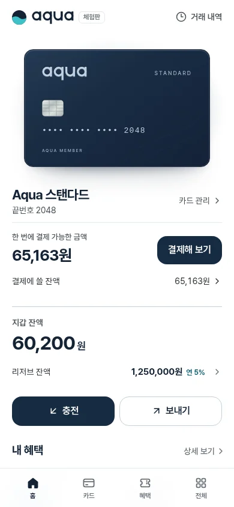
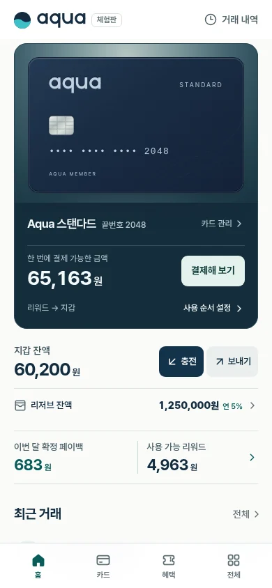
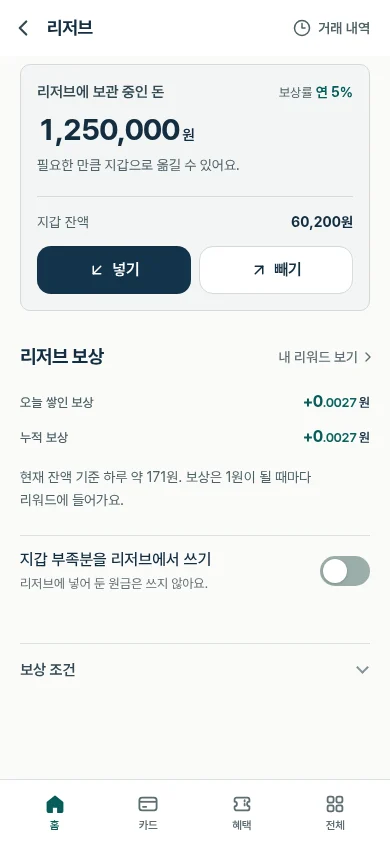
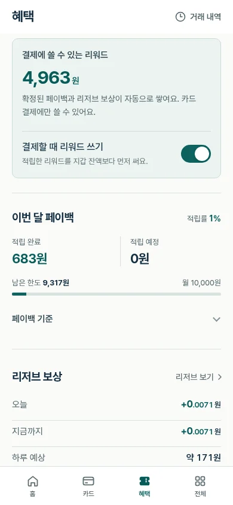

# Aqua Card 화면

발급된 체험 계정으로 찍은 화면이다. 홈의 지갑 잔액은 60,200원이고 리워드는 4,963원이다. 리워드 사용이 켜져 있어 한 번에 65,163원을 결제할 수 있다. 리저브에 따로 보관한 1,250,000원은 지갑 부족분을 리저브에서 쓰도록 설정할 때만 결제에 쓸 수 있다.

| 개편 전 | 개편 후 |
| --- | --- |
|  |  |

[데스크톱 홈 개편 전](review-home-desktop-before.webp) · [개편 후](review-home-desktop-after.webp) · [내 카드](review-card-phone.webp)

## 금액 읽기

| 리저브 | 혜택 | 결제 영수증 |
| --- | --- | --- |
|  |  |  |

홈에서 보이는 ‘이번 달 확정 페이백’은 그달의 적립 내역이다. ‘사용 가능 리워드’는 지난 적립, 이미 쓴 금액, 리저브 보상까지 반영한 현재 잔액이다. 리워드를 먼저 쓰도록 설정하면 결제 영수증에서 이번에 얼마를 썼는지 확인할 수 있다.

## 가입과 카드 관리

[가입 중 현재 단계](review-signup-desktop.webp) · [모바일 카드 신청](review-application-phone.webp) · [전체 설정](review-settings-desktop.webp) · [서버에 연결한 카드 홈](connected-home.webp)

## 참고한 디자인 자료

- 홈의 첫 시선은 실제 카드에 두었다. 지갑과 혜택은 같은 모양의 상자를 반복하는 대신 제목, 금액, 간격으로 구분했다. [Anthropic frontend-design](https://github.com/anthropics/skills/blob/main/skills/frontend-design/SKILL.md)
- 송금 확인 단계에서는 받는 사람, 금액과 수수료를 같은 위치에서 읽고 입력 단계로 돌아갈 수 있다. [GOV.UK Check answers](https://design-system.service.gov.uk/patterns/check-answers/) · [Summary list](https://design-system.service.gov.uk/components/summary-list/)
- 거래 목록에서는 거래명과 금액을 먼저 읽고 날짜, 승인 상태를 뒤에 둔다. 행 전체를 눌러 전표를 연다. [Material Web Lists](https://github.com/material-components/material-web/blob/main/docs/components/list.md)
- 설정은 글자나 스위치 어디를 눌러도 바뀐다. 키보드 초점, 고정된 하단 탭, 좁은 화면에서 금액과 버튼이 서로 가리는지 검사한다. [Vercel Web Interface Guidelines](https://github.com/vercel-labs/web-interface-guidelines/blob/main/command.md)

현재 소스로 체험하려면 저장소에서 `npm ci` 후 `npm run dev -- --mode mobile-preview`를 실행한다. `/?scenario=issued`는 카드 홈, `/?scenario=signup`은 가입에서 시작하며 진행 상태는 따로 보관한다. [이전에 공개한 PR 26 체험판](https://sohw400.github.io/aquacard/preview/pr-26/?scenario=issued)
