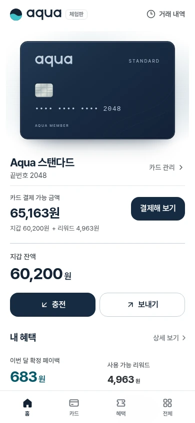
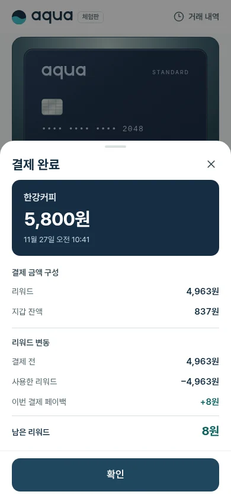
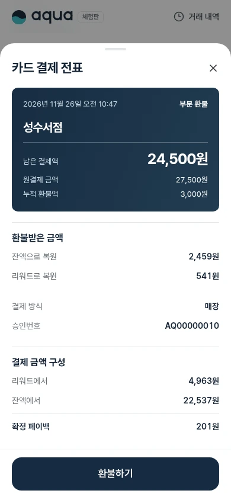
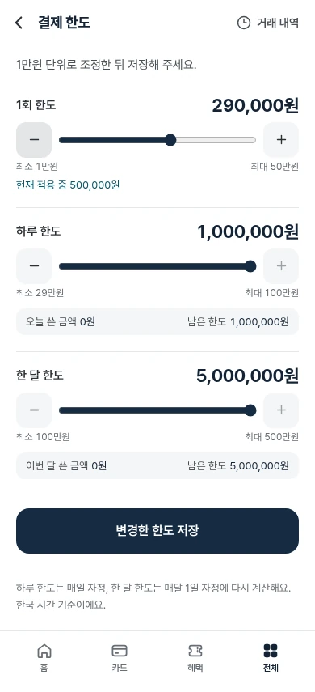
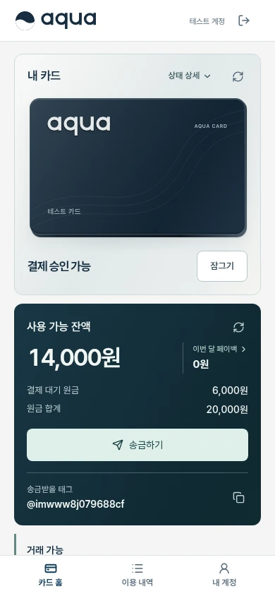
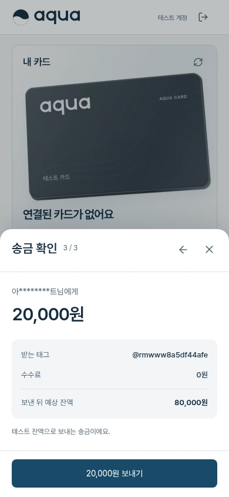
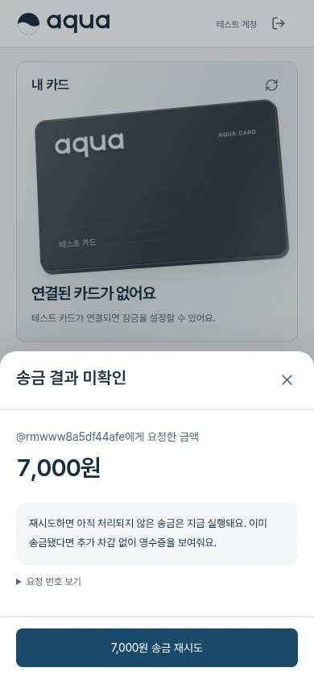
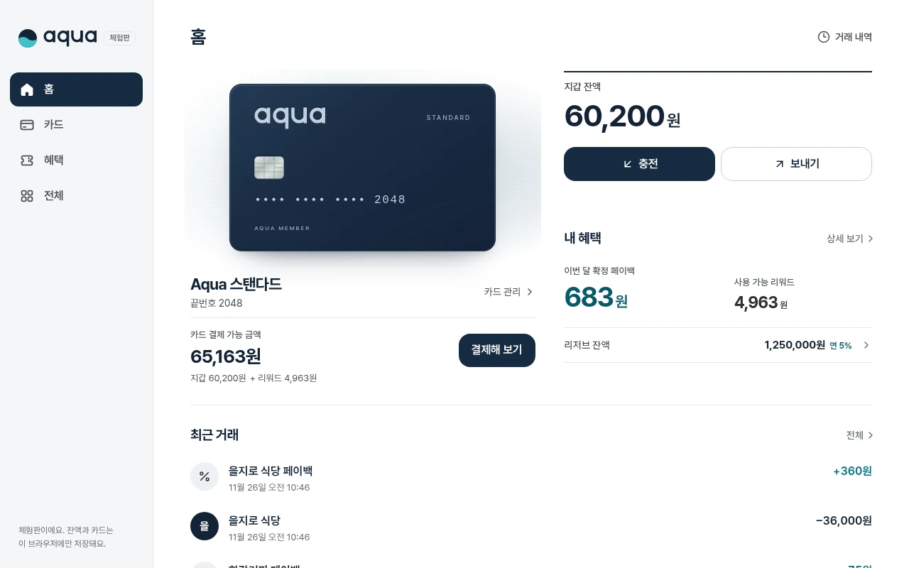

# Aqua Card 화면과 디자인 검토

카드 홈, 혜택, 결제와 환불, 송금 흐름을 검토했습니다. 모바일 이미지는 390px, 데스크톱 이미지는 1280px에서 캡처했습니다. 금액과 거래는 테스트 데이터입니다.

| 카드 홈 | 혜택 |
| --- | --- |
|  |  |

| 결제 직후 영수증 | 부분 환불 후 전표 |
| --- | --- |
|  |  |

| 결제 한도 변경 | 서버 연결 카드 홈 |
| --- | --- |
|  |  |

| 서버 연결 송금 확인 | 응답이 끊긴 송금 |
| --- | --- |
|  |  |

## 리뷰에서 바뀐 점

| 관찰한 문제 | 반영한 내용 |
| --- | --- |
| 카드로 쓸 수 있는 금액과 지갑 잔액이 달라도 이유를 바로 알기 어려웠습니다. | 총액 아래에 현재 설정으로 쓸 수 있는 지갑·리워드·리저브 금액을 표시합니다. 혜택의 대표 금액도 결제할 수 있는 원 단위로 맞췄습니다. |
| 서버 연결 홈에서 카드 상태와 잠금 상태를 연달아 읽어야 했습니다. | 정상 카드는 결제 승인 여부 옆에서 바로 잠글 수 있습니다. 확인 시각은 상세에서 보고, 처리 중이거나 제한된 카드는 이유를 바로 읽을 수 있습니다. |
| 작은 화면의 부분 환불 전표에서는 원결제액만 먼저 보였습니다. | 전표 상단에 남은 결제액, 원결제액, 누적 환불액을 모았습니다. 320px에서 세 값이 스크롤 없이 보입니다. |
| 영수증에서 Tab 키를 누르면 닫기와 본문 사이를 반복했습니다. | 본문에서 확인·환불하기까지 이동하고 Shift+Tab으로 돌아갈 수 있습니다. |
| ‘결과 확인’이라는 버튼이 미처리된 송금을 실행할 수 있었습니다. | 원래 받는 사람과 금액, 재시도의 결과를 함께 표시하고 버튼에 송금액을 적었습니다. 이미 처리된 송금은 같은 요청으로 영수증을 돌려줍니다. |

두 리뷰 에이전트가 화면 캡처와 거래 흐름을 각각 검토했습니다. 수정한 전표와 영수증은 Chromium 320×568에서 키보드로 다시 확인했습니다. 실제 고객 사용성 조사와 실기기 화면 낭독기 검증은 별도로 남아 있습니다.

## 휴대폰에서 열기

- [신규 가입과 카드 신청](https://sohw400.github.io/aquacard/preview/pr-26/?scenario=signup)에서 가입부터 시작합니다. 주소와 고객확인은 화면의 체험용 정보를 사용하세요.
- [발급된 카드로 결제하기](https://sohw400.github.io/aquacard/preview/pr-26/?scenario=issued)에서 바로 카드 홈을 엽니다. 처음에는 지갑 60,200원과 리워드 4,963원을 쓸 수 있습니다. 리저브 보상은 시간이 지나면 더해집니다.

발급된 카드로 **결제해 보기**를 눌러 27,500원을 결제한 뒤 영수증에서 쓴 리워드와 새 페이백을 확인하세요. 홈의 최근 거래에서 같은 결제를 열어 3,000원을 환불하면 남은 결제액은 24,500원입니다.

두 링크는 같은 브라우저에서도 진행 상태를 따로 보관합니다. 발급된 체험 계정에서 로그아웃했다면 `mobile.preview@example.test`와 `AquaPreview2026`으로 다시 로그인할 수 있습니다.
